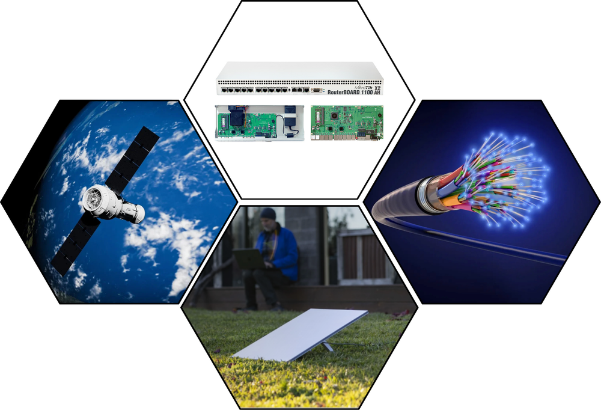
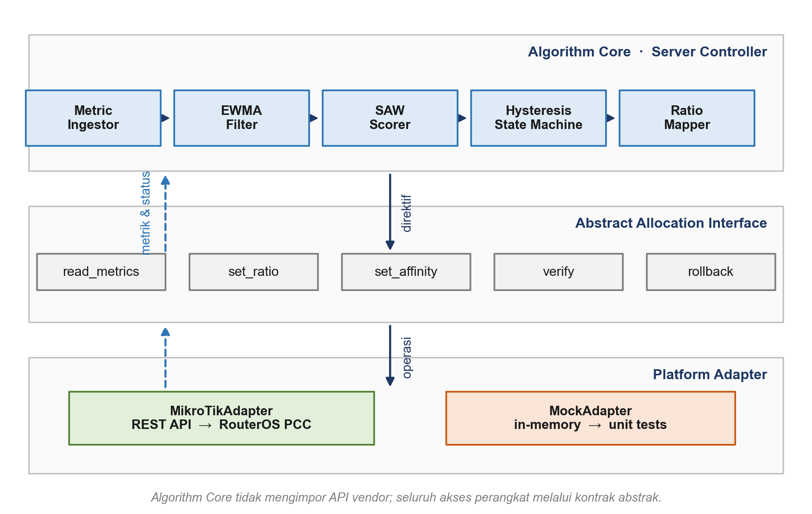
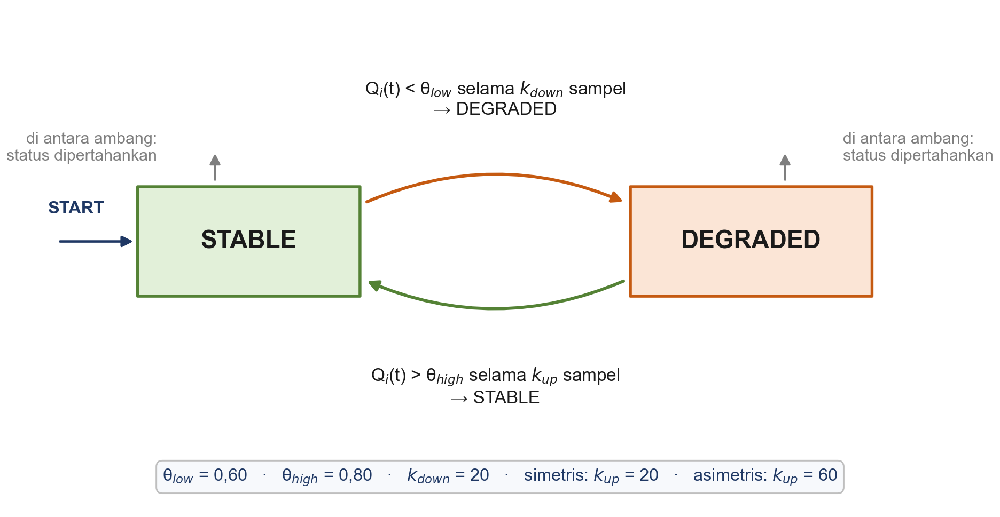
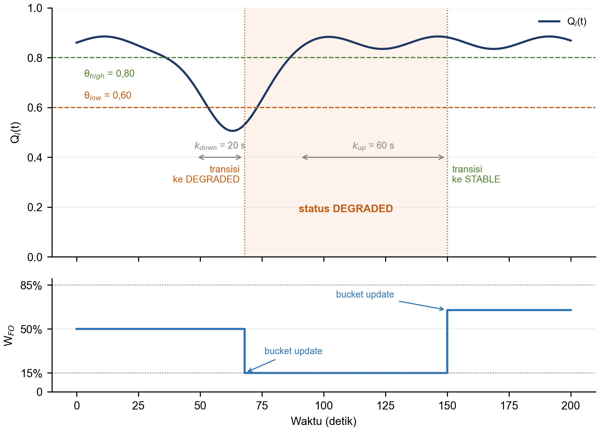
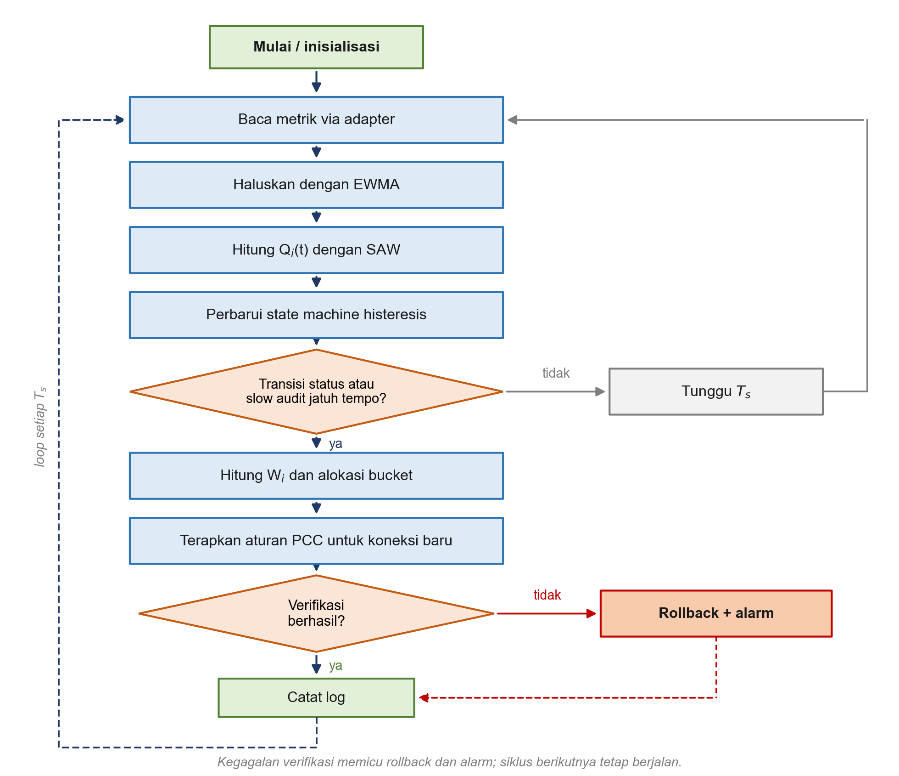

::: {custom-style="CoverLabel"}
TESIS
:::

::: {custom-style="CoverTitle"}
Pengembangan Session-Preserving Asymmetric Hysteresis State Machine untuk Kendali Proporsi Aliran Adaptif WAN Heterogen FO–LEO
:::

::: {custom-style="CoverEnglishTitle"}
Session-Preserving Asymmetric Hysteresis State Machine for Adaptive Flow Proportion Control in Heterogeneous FO–LEO WANs
:::

::: {custom-style="CoverFigure"}
{width=11cm}
:::

::: {custom-style="CoverLogo"}
{width=2.5cm}
:::

::: {custom-style="CoverAuthor"}
KASMIL PAPALIA

D082252011
:::

::: {custom-style="CoverMeta"}
PROGRAM STUDI MAGISTER TEKNIK INFORMATIKA

DEPARTEMEN TEKNIK INFORMATIKA

FAKULTAS TEKNIK

UNIVERSITAS HASANUDDIN GOWA

2026
:::

```{=openxml}
<w:p><w:r><w:br w:type="page"/></w:r></w:p>
```

::: {custom-style="FrontTitle"}
LEMBAR PENGESAHAN PROPOSAL PENELITIAN
:::

::: {custom-style="ApprovalTitle"}
PENGEMBANGAN SESSION-PRESERVING ASYMMETRIC HYSTERESIS STATE MACHINE UNTUK KENDALI PROPORSI ALIRAN ADAPTIF WAN HETEROGEN FO–LEO
:::

::: {custom-style="ApprovalName"}
KASMIL PAPALIA

D082252011
:::

::: {custom-style="ApprovalBody"}
Disetujui untuk diseminarkan

Komisi Pembimbing

Pembimbing I
:::

::: {custom-style="ApprovalName"}
Dr. Eng. Ady Wahyudi Paundu, S.T., M.T.

NIP: 19750313 200912 1 003
:::

::: {custom-style="ApprovalBody"}
Ketua Program Studi S2 Informatika
:::

::: {custom-style="ApprovalName"}
Prof. Dr. Ir. Zahir Zainuddin, M.Sc

NIP: 19640427 198910 1 002
:::

```{=openxml}
<w:p><w:r><w:br w:type="page"/></w:r></w:p>
```

::: {custom-style="FrontTitle"}
ABSTRAK
:::

Jaringan multi-ISP yang menggabungkan jalur Fiber Optic (FO) dan satelit Low Earth Orbit (LEO) menghadapi dua sumber ketidakstabilan yang berbeda: variasi operasional pada FO dan dinamika fisik-atmosferik pada LEO. Per Connection Classifier (PCC) pada RouterOS MikroTik mampu menjaga konsistensi sesi, tetapi rasio pembagiannya umumnya ditetapkan statis sehingga tidak merespons degradasi link secara real-time. Pembaruan rasio yang terlalu agresif juga berisiko menimbulkan flapping dan mengganggu sesi yang sedang berjalan. Penelitian ini mengusulkan Session-Preserving Asymmetric Hysteresis State Machine (SPA-HSM), yaitu arsitektur kontrol tiga lapis yang memisahkan Algorithm Core, Abstract Allocation Interface, dan Platform Adapter. Algorithm Core menghaluskan metrik dengan Exponentially Weighted Moving Average (EWMA), menghitung skor kualitas link dengan Simple Additive Weighting (SAW), lalu menentukan status link melalui histeresis asimetris dengan ambang degradasi dan pemulihan yang berbeda. Abstract Allocation Interface menerjemahkan status menjadi direktif rasio dan AFFINITY_LOCK, sedangkan Platform Adapter menerapkannya pada PCC MikroTik hanya untuk koneksi baru. Evaluasi dirancang sebagai studi ablasi faktorial 3 × 2 yang membandingkan varian tanpa histeresis, histeresis simetris, dan histeresis asimetris, masing-masing dengan affinity lock aktif atau nonaktif, terhadap PCC statis dan baseline praktisi. Luaran yang diharapkan adalah model SPA-HSM yang terukur, bukti empiris kontribusi setiap komponen terhadap flapping, TCP RST rate, goodput, dan latensi, serta pedoman parameter untuk jaringan dual-ISP FO–LEO skala RT/RW Net.

**Kata kunci:** SPA-HSM, PCC, histeresis asimetris, EWMA, SAW, preservasi sesi

```{=openxml}
<w:p><w:r><w:br w:type="page"/></w:r></w:p>
```

::: {custom-style="FrontTitle"}
ABSTRACT
:::

Multi-ISP networks that combine Fiber Optic (FO) and Low Earth Orbit (LEO) satellite links face two distinct sources of instability: operational variability on FO and physical-atmospheric dynamics on LEO. The Per Connection Classifier (PCC) on MikroTik RouterOS preserves session consistency, but its splitting ratio is typically static and therefore cannot respond to link degradation in real time. Overly aggressive ratio updates may also cause flapping and disrupt active sessions. This study proposes a Session-Preserving Asymmetric Hysteresis State Machine (SPA-HSM), a three-layer control architecture that separates the Algorithm Core, Abstract Allocation Interface, and Platform Adapter. The Algorithm Core smooths metrics with an Exponentially Weighted Moving Average (EWMA), computes link quality scores with Simple Additive Weighting (SAW), and determines link status through asymmetric hysteresis with distinct degradation and recovery thresholds. The Abstract Allocation Interface translates status into ratio directives and AFFINITY_LOCK, while the Platform Adapter applies them to MikroTik PCC for new connections only. The evaluation is designed as a 3 × 2 factorial ablation study comparing variants without hysteresis, with symmetric hysteresis, and with asymmetric hysteresis, each with affinity lock enabled or disabled, against static PCC and a practitioner baseline. The expected outcomes are a measurable SPA-HSM model, empirical evidence of each component's contribution to flapping, TCP RST rate, goodput, and latency, and parameter guidelines for dual-ISP FO–LEO networks at the RT/RW Net scale.

**Keywords:** SPA-HSM, PCC, asymmetric hysteresis, EWMA, SAW, session preservation

```{=openxml}
<w:p><w:r><w:br w:type="page"/></w:r></w:p>
```

::: {custom-style="FrontTitle"}
DAFTAR ISI
:::

TOC_PLACEHOLDER

```{=openxml}
<w:p><w:r><w:br w:type="page"/></w:r></w:p>
```

::: {custom-style="FrontTitle"}
DAFTAR TABEL
:::

TABLE_LIST_PLACEHOLDER

```{=openxml}
<w:p><w:r><w:br w:type="page"/></w:r></w:p>
```

::: {custom-style="FrontTitle"}
DAFTAR GAMBAR
:::

FIGURE_LIST_PLACEHOLDER

```{=openxml}
<w:p><w:r><w:br w:type="page"/></w:r></w:p>
```

::: {custom-style="FrontTitle"}
DAFTAR SINGKATAN, ISTILAH, DAN LAMBANG
:::

| Simbol/Singkatan | Arti | Keterangan |
|---|---|---|
| `AFFINITY_LOCK` | Direktif penahan sesi | Flag pada Abstract Allocation Interface |
| EWMA | Exponentially Weighted Moving Average | Filter penghalus deret waktu |
| FO | Fiber Optic | Jalur WAN terestrial |
| GEE | Generalized Estimating Equations | Model statistik data longitudinal |
| LEO | Low Earth Orbit | Satelit orbit rendah (Starlink) |
| MCDM | Multi-Criteria Decision Making | Kerangka keputusan multi-kriteria |
| NDLC | Network Development Life Cycle | Kerangka pengembangan sistem jaringan |
| PCC | Per Connection Classifier | Metode load balancing RouterOS |
| QoS | Quality of Service | Kualitas layanan jaringan |
| QoE | Quality of Experience | Pengalaman pengguna (di luar cakupan) |
| RST | TCP Reset | Indikator gangguan sesi |
| SAW | Simple Additive Weighting | Metode skoring MCDM |
| SDN | Software-Defined Networking | Kontrol terpisah dari data plane |
| SPA-HSM | Session-Preserving Asymmetric Hysteresis State Machine | Sistem yang diusulkan |
| TCP | Transmission Control Protocol | Protokol transport |
| WAN | Wide Area Network | Jaringan area luas |
| $Q_i(t)$ | Skor kualitas link ke-i | 0–1 |
| $E_i(t)$ | Nilai metrik terhaluskan | EWMA |
| $x_i(t)$ | Nilai metrik mentah |—|
| $r_{ij}$ | Nilai ternormalisasi kriteria j | 0–1 |
| $w_j$ | Bobot kriteria j | $\sum w_j = 1$ |
| $\theta_{low}$ | Ambang degradasi | 0–1 |
| $\theta_{high}$ | Ambang pemulihan | 0–1 |
| $k_{down}$ | Dwell degradasi | sampel |
| $k_{up}$ | Dwell pemulihan | sampel |
| $T_s$ | Interval sampling | detik |
| $\alpha$ | Koefisien EWMA | 0–1 |
| $N$ | Jumlah bucket PCC | integer |
| $W_i$ | Rasio target link ke-i | 0–1 |
| $H_i$ | Headroom link ke-i | Mbps |

```{=openxml}
<w:p><w:r><w:br w:type="page"/></w:r></w:p>
```

# BAB I

::: {custom-style="ChapterSubtitle"}
PENDAHULUAN
:::

## 1.1 Latar Belakang

Transformasi digital dan meningkatnya ketergantungan pada aplikasi terdistribusi menuntut penyedia layanan jaringan menjamin ketersediaan koneksi (*high availability*) sekaligus performa *Quality of Service* (QoS) yang berkelanjutan (Amalia et al., 2022). Untuk mengantisipasi kegagalan tunggal (*single point of failure*) dan mengoptimalkan pemanfaatan lebar pita, adopsi arsitektur multi-ISP telah menjadi praktik standar pada infrastruktur jaringan *enterprise*. Agregasi lintas penyedia yang mencakup jalur terestrial (serat optik, seluler 4G/5G) maupun jalur satelit (LEO dan GEO) kini dipandang sebagai prasyarat untuk memperoleh konektivitas yang andal, hemat biaya, dan berkinerja tinggi (Ali et al., 2025). Namun, penggabungan dua atau lebih jalur transmisi heterogen menghadirkan kompleksitas teknis tersendiri, terutama ketika infrastruktur yang digabungkan memiliki karakteristik fisik dan dinamika propagasi yang berbeda secara mendasar (Chen et al., 2025).

Heterogenitas tersebut paling tereksplisitkan pada integrasi jalur *Fiber Optic* (FO) terestrial dengan jaringan satelit *Low Earth Orbit* (LEO) seperti Starlink. Secara arsitektural, jalur FO unggul dalam latensi rendah, *throughput* tinggi, dan *packet loss* minim karena sifat transmisinya yang berbasis kabel dan terlindung dari gangguan atmosferik. Meski demikian, kualitas layanan FO dalam praktik operasional tidak selalu identik dengan kapasitas nominal yang tercantum pada kontrak berlangganan. Kebijakan *oversubscription*, *contention ratio* pada jam sibuk, serta kondisi jaringan akses dapat menyebabkan *throughput* aktual yang diterima pelanggan berada di bawah kapasitas nominal. Gejala ini bersifat operasional-komersial dan berbeda dari keterbatasan fisik medium transmisinya, sehingga kualitas FO perlu dievaluasi secara berkala dan tidak dapat diasumsikan konstan.

Sebaliknya, jalur LEO menyediakan *throughput* tinggi hingga ke lokasi terpencil, tetapi secara empiris bersifat stokastik. Pengukuran dari sisi pengguna akhir menunjukkan bahwa dinamika *throughput* dan latensi Starlink jauh lebih besar dibandingkan jaringan terestrial, disertai kejadian *outage* yang relatif sering (Ma et al., 2023). Pada wilayah beriklim tropis, degradasi jalur LEO diperparah oleh *rain fade*; curah hujan teridentifikasi sebagai prediktor terkuat terhadap penurunan *throughput* (Boeckenholt et al., 2024), dengan penurunan *throughput downlink* median dari sekitar 137 Mbps menjadi 90 Mbps dan *uplink* dari 20,9 Mbps menjadi 10,5 Mbps pada kondisi hujan (Ullah et al., 2025). Selain itu, karakterisasi *one-way delay* menunjukkan pola periodik sekitar 15 detik yang paling terdampak pada arah *uplink* (Garcia et al., 2025), dan pola serupa terobservasi sebagai penurunan *throughput* berulang pada batas interval tersebut (Hammer et al., 2024; Mohan et al., 2024). Dengan demikian, jalur LEO mengandung dua lapis ketidakstabilan: degradasi lambat berskala menit akibat cuaca dan transien cepat berskala detik akibat rekonfigurasi/handover.

Untuk mendistribusikan beban pada jaringan multi-ISP, metode *Per Connection Classifier* (PCC) pada RouterOS MikroTik banyak dimanfaatkan. PCC mengelompokkan trafik berdasarkan kombinasi atribut koneksi sehingga seluruh paket dalam satu sesi komunikasi konsisten dialirkan melalui *gateway* WAN yang sama; sifat ini mengurangi risiko *packet reordering* yang merusak kinerja TCP (Kumar dan Golash, 2009; MikroTik, n.d.). Efektivitas PCC telah diverifikasi secara empiris: penerapannya pada topologi dua ISP menghasilkan skor QoS 3,75 pada jam sibuk dan 4,00 pada jam normal berdasarkan standar TIPHON (Amalia et al., 2022), sementara implementasi pada tiga ISP meningkatkan *throughput* sebesar 9,32 Mbps, menurunkan *delay* 43,54 ms, dan menurunkan *jitter* 74,17 ms dengan *packet loss* tetap 0% (Arfianita et al., 2024). Studi komparatif juga menempatkan PCC lebih unggul dalam menjaga stabilitas koneksi dibanding ECMP dan Nth pada trafik *stateful* (Nugroho et al., 2023; Putra dan Anton, 2024; Mirsal dan Agtriadi, 2026).

Meskipun demikian, seluruh implementasi tersebut masih bertumpu pada rasio pembagian yang statis-deterministik. Nilai rasio, misalnya 1:1 atau 2:1, ditetapkan pada tahap konfigurasi berdasarkan kapasitas teoretis dan tidak dievaluasi ulang terhadap kondisi *link* secara *real-time*. Konsekuensinya, ketika salah satu ISP terdegradasi—misalnya lonjakan latensi Starlink akibat hujan atau *handover*, atau penurunan kecepatan FO pada jam sibuk—*router* tetap menyalurkan proporsi trafik sesuai rasio semula. Alokasi yang tidak sadar-kondisi ini dapat menurunkan QoS agregat, memperbesar latensi, dan mengurangi *goodput*, terutama ketika jalur yang menerima porsi besar justru sedang mengalami degradasi.

Untuk mengatasi rigiditas tersebut, diperlukan mekanisme pengambilan keputusan dinamis yang bekerja di luar *data plane router*. Pola *offloading controller*—*controller* eksternal membaca metrik, menghitung kebijakan, lalu menyuntikkan aturan ke perangkat—telah lazim pada arsitektur yang menyerupai *Software-Defined Networking* (SDN) (Ali et al., 2025; Wang dan Kuo, 2013). Namun, penerapan pola ini pada PCC menghadapi tiga persoalan yang saling terkait. Pertama, metrik QoS bersifat derau dan mengandung transien; pembaruan rasio pada setiap siklus *polling* dapat memicu *flapping*, yaitu perubahan aturan yang berbalik arah secara berulang. Kedua, perubahan aturan PCC berpotensi memengaruhi sesi yang sedang berjalan; tanpa mekanisme preservasi, koneksi TCP dapat mengalami *reordering*, retransmisi, bahkan *reset*. Ketiga, logika keputusan sering kali tertanam pada vendor atau perangkat tertentu, sehingga sulit diuji ulang dan direplikasi pada platform lain.

Sejumlah penelitian telah membahas bagian-bagian persoalan tersebut secara terpisah. Literatur MCDM membahas pemilihan jaringan dan pembobotan kriteria (Wang dan Kuo, 2013; Vafaei et al., 2021); literatur kontrol membahas histeresis dan ambang untuk mencegah osilasi (Tournaire et al., 2023); literatur PCC membahas distribusi beban dan *failover* (Amalia et al., 2022; Arfianita et al., 2024; Nugroho et al., 2023); sedangkan literatur Starlink mengarakterisasi dinamika *link* LEO (Ma et al., 2023; Garcia et al., 2025; Hammer et al., 2024). Namun, belum ditemukan penelitian yang secara eksplisit menyatukan keempat elemen—skor kualitas multi-kriteria, penghalusan deret waktu, histeresis asimetris, dan preservasi sesi—dalam satu *state machine* yang mengendalikan proporsi aliran PCC pada WAN heterogen FO–LEO. Celah inilah yang menjadi posisi penelitian ini.

Penelitian ini mengusulkan *Session-Preserving Asymmetric Hysteresis State Machine* (SPA-HSM), yaitu arsitektur kontrol lingkaran tertutup yang terdiri atas tiga lapis. Lapis *Algorithm Core* mengeksekusi EWMA untuk menghaluskan metrik, SAW untuk menghasilkan skor kualitas $Q_i(t)$, *state machine* histeresis asimetris untuk menentukan status *link*, dan pemetaan rasio untuk menghasilkan proporsi alokasi. Lapis *Abstract Allocation Interface* menerjemahkan status dan rasio menjadi direktif abstrak, termasuk `AFFINITY_LOCK` untuk menjaga sesi yang sedang berjalan. Lapis *Platform Adapter* menerjemahkan direktif tersebut menjadi aturan *mangle/routing* PCC pada RouterOS MikroTik melalui REST API, dengan pembaruan yang dibatasi pada `connection-state=new`. Dengan pemisahan ini, algoritma tidak bergantung pada vendor, sementara MikroTik berperan sebagai *testbed* eksekutor *data plane*, bukan sebagai objek penelitian.

Kontribusi yang diharapkan dari penelitian ini adalah: (1) formalisasi SPA-HSM yang menggabungkan EWMA, SAW, histeresis asimetris, dan preservasi sesi dalam satu *state machine*; (2) rancangan arsitektur tiga lapis dengan kontrak antarmuka yang memungkinkan pengujian portabilitas melalui *mock adapter*; (3) evaluasi ablasi yang memisahkan kontribusi histeresis dan *affinity lock* terhadap *flapping*, TCP RST *rate*, *goodput*, dan latensi; serta (4) pedoman parameter praktis untuk jaringan dual-ISP FO–LEO skala RT/RW Net. Ruang lingkup penelitian dibatasi pada topologi dual-ISP, Starlink sebagai kasus acuan *upper bound*, bobot SAW statis yang dikalibrasi di awal, dan MikroTik sebagai *platform adapter*.

## 1.2 Tinjauan Pustaka

### 1.2.1 Konsep Quality of Service (QoS)

*Quality of Service* (QoS) merupakan ukuran kemampuan suatu jaringan dalam memberikan jaminan performa terhadap trafik yang dilewatkannya. QoS umumnya direpresentasikan melalui empat parameter utama: *delay* (waktu tempuh paket dari sumber ke tujuan), *jitter* (variasi *delay* antar-paket), *packet loss* (rasio paket yang gagal sampai ke tujuan), dan *throughput* (laju data efektif yang berhasil ditransmisikan) (Nanang et al., 2024). Ketika terjadi gangguan pada jaringan, keempat parameter tersebut cenderung terdegradasi secara bersamaan, sehingga pemantauan berkelanjutan terhadap kombinasinya menjadi penting untuk mengantisipasi kegagalan layanan sebelum berdampak pada pengguna akhir (Nanang et al., 2024).

Pada konteks jaringan multi-ISP, evaluasi QoS umumnya diacu pada standar seperti *Telecommunications and Internet Protocol Harmonization Over Networks* (TIPHON), yang mengategorikan skor gabungan keempat parameter ke dalam indeks kepuasan layanan (Amalia et al., 2022; ETSI, 2000). Standar ITU-T G.114 memberikan batas *one-way delay* untuk layanan interaktif, sedangkan ITU-T Y.1541 menetapkan objektif performa jaringan berbasis IP untuk beberapa kelas layanan (ITU-T, 2003, 2011). Di sisi pengukuran, RFC 2330 menyediakan kerangka metrik performa IP, RFC 2544 menetapkan metodologi *benchmarking* perangkat jaringan, dan RFC 3550 mendefinisikan estimasi *jitter* untuk trafik *real-time* (Paxson et al., 1998; Bradner dan McQuaid, 1999; Schulzrinne et al., 2003). Penelitian ini mengadopsi keempat parameter tersebut sebagai kriteria dasar penyusunan skor kualitas, dengan *throughput* diperlakukan sebagai atribut *benefit* dan tiga parameter lainnya sebagai atribut *cost*. Perlu ditegaskan bahwa penelitian ini mengukur QoS, bukan *Quality of Experience* (QoE) yang memerlukan persepsi pengguna.

### 1.2.2 Karakteristik ISP Fiber Optic (FO) dan LEO (Starlink)

Jalur FO secara arsitektural unggul dalam latensi rendah, *throughput* tinggi, dan *packet loss* minim karena sifat transmisinya yang berbasis kabel dan terlindung dari gangguan atmosferik. Meskipun demikian, kualitas layanan FO dalam praktik operasional dapat dipengaruhi oleh kebijakan *oversubscription*, *contention ratio*, dan kondisi jaringan akses. Berbeda dari FO, terminal satelit LEO seperti Starlink beroperasi pada ketinggian orbit rendah (sekitar 550 km) yang memungkinkan latensi jauh lebih kecil dibanding satelit GEOstasioner, tetapi dengan konsekuensi jaringan harus melakukan penyerahan koneksi (*handover*) antar-satelit secara periodik.

Pengukuran dari sisi pengguna akhir menunjukkan bahwa dinamika *throughput* dan latensi Starlink jauh lebih besar dibandingkan jaringan terestrial, disertai kejadian *outage* yang relatif sering (Ma et al., 2023). Curah hujan teridentifikasi sebagai prediktor terkuat terhadap penurunan *throughput* (Boeckenholt et al., 2024), dengan penurunan *throughput downlink* median dari sekitar 137 Mbps menjadi 90 Mbps pada kondisi hujan (Ullah et al., 2025). Di sisi lain, karakterisasi *one-way delay* menegaskan bahwa arah *uplink* paling terdampak oleh siklus rekonfigurasi periodik 15 detik (Garcia et al., 2025), sebuah pola yang juga terobservasi sebagai penurunan *throughput* berulang dari sisi *edge router* pengguna (Hammer et al., 2024; Mohan et al., 2024). Perbedaan skala waktu—degradasi lambat akibat cuaca dan transien cepat akibat *handover*—menjadi dasar perancangan penghalusan deret waktu dan histeresis pada penelitian ini. Integrasi satelit–terestrial juga dibahas dalam tinjauan arsitektur jaringan 6G dan teknologi *inter-satellite link* (Chen et al., 2025; Ji et al., 2026).

### 1.2.3 Per Connection Classifier (PCC) dan RouterOS

PCC adalah metode *load balancing* pada RouterOS yang mengelompokkan trafik berdasarkan kombinasi atribut koneksi, misalnya *source address*, *destination address*, dan *port*. Seluruh paket dalam satu sesi komunikasi konsisten dialirkan melalui *gateway* WAN yang sama, sehingga terhindar dari *packet reordering* yang dapat memicu retransmisi dan penurunan *throughput* TCP (Kumar dan Golash, 2009; MikroTik, n.d.). Implementasi PCC pada RouterOS menggunakan aturan *mangle* untuk memberi *connection mark* dan *routing mark*, yang kemudian dipakai oleh tabel routing untuk memilih *gateway*. Koneksi yang sudah terbentuk mempertahankan *connection mark* pada *connection tracking* (*conntrack*), sedangkan koneksi baru mengikuti aturan yang berlaku saat paket pertama diproses.

Efektivitas PCC telah diverifikasi pada berbagai topologi. Penerapan pada dua ISP menghasilkan skor QoS 3,75 pada jam sibuk dan 4,00 pada jam normal berdasarkan standar TIPHON (Amalia et al., 2022), sementara penerapan pada tiga ISP meningkatkan *throughput* sebesar 9,32 Mbps dan menurunkan *jitter* hingga 74,17 ms dengan *packet loss* tetap 0% (Arfianita et al., 2024). Studi komparatif menempatkan PCC lebih unggul dalam menjaga stabilitas koneksi dibanding ECMP dan Nth pada trafik *stateful* (Nugroho et al., 2023), serta lebih stabil dibanding *Queue Tree* dalam skenario tertentu (Mirsal dan Agtriadi, 2026). Implementasi PCC dengan *failover* juga terbukti mengurangi dampak gangguan salah satu ISP (Putra dan Anton, 2024). Namun, seluruh studi tersebut menetapkan rasio pembagian secara statis pada tahap konfigurasi dan tidak mengevaluasi ulang rasio terhadap kondisi *link* secara *real-time*.

### 1.2.4 Load Balancing Adaptif dan Pendekatan Terkait

Selain PCC, RouterOS menyediakan *Equal-Cost Multi-Path* (ECMP) dan Nth sebagai alternatif pembagian beban. ECMP mendistribusikan sesi secara merata lintas rute dengan biaya (*cost*) setara, sedangkan Nth membagi koneksi berdasarkan urutan kedatangan paket ke-n tanpa mempertimbangkan atribut sesi. Studi komparatif menunjukkan bahwa PCC unggul dalam konsistensi sesi dan stabilitas koneksi aplikasi *stateful*, ECMP unggul dalam pemerataan beban murni saat seluruh sesi bersifat independen, sedangkan Nth memiliki *overhead* komputasi paling rendah tetapi rentan menimbulkan distribusi yang tidak merata (Nugroho et al., 2023).

Pendekatan adaptif yang lebih baru mencakup *hub* konektivitas berbasis *Artificial Neural Network* (ANN) untuk mengalokasikan *data rate* lintas ISP berdasarkan latensi, *throughput*, kongesti, dan biaya (Ali et al., 2025), serta metode metaheuristik untuk *load balancing* di lingkungan *cloud* (Komathi et al., 2024; Lilhore et al., 2025). Pendekatan tersebut menunjukkan manfaat alokasi sadar-kondisi, tetapi umumnya membutuhkan sumber daya komputasi besar, tidak dirancang untuk perangkat SOHO, dan tidak secara eksplisit menjaga konsistensi sesi TCP. Literatur pemilihan jaringan heterogen juga membahas MCDM untuk memilih akses terbaik (Wang dan Kuo, 2013), tetapi belum diterjemahkan menjadi mekanisme alokasi proporsi PCC yang dapat dieksekusi pada siklus kendali berskala detik. Celah ini menunjukkan perlunya metode yang ringan, interpretable, dan sadar-sesi.

### 1.2.5 Multi-Criteria Decision Making (MCDM) dan SAW

MCDM adalah kerangka pengambilan keputusan yang mengevaluasi sejumlah alternatif berdasarkan lebih dari satu kriteria yang saling bertentangan atau memiliki satuan berbeda. Pada persoalan seleksi jaringan heterogen, sejumlah metode MCDM lazim digunakan, antara lain *Simple Additive Weighting* (SAW), *Analytical Hierarchy Process* (AHP), *Technique for Order Preference by Similarity to Ideal Solution* (TOPSIS), dan *Weighted Product Method* (WPM). AHP dan TOPSIS umumnya memberikan hasil yang lebih robust terhadap kriteria yang saling bergantung, tetapi membutuhkan perbandingan berpasangan atau perhitungan jarak Euclidean yang lebih mahal secara komputasi dibanding SAW yang bersifat linier aditif (Wang dan Kuo, 2013).

SAW menghasilkan skor akhir tiap alternatif melalui penjumlahan hasil kali antara nilai kriteria yang telah dinormalisasi dengan bobot kepentingan masing-masing kriteria. Proses normalisasi membedakan dua tipe atribut: atribut *benefit* (semakin besar nilai semakin baik, seperti *throughput*) dan atribut *cost* (semakin kecil nilai semakin baik, seperti *delay*, *jitter*, dan *packet loss*). Pemilihan teknik normalisasi terbukti memengaruhi hasil peringkat akhir secara signifikan, sehingga pemilihannya perlu disesuaikan dengan karakteristik data *cost-benefit* yang dievaluasi (Vafaei et al., 2021). Pada penelitian ini, normalisasi menggunakan batas acuan tetap yang mengacu pada standar QoS, bukan nilai minimum/maksimum antar-*link* pada setiap siklus. Tujuannya agar skor $Q_i(t)$ tetap dapat dibandingkan antar-waktu dan tidak berubah skalanya ketika kondisi *link* lain berubah. Konsekuensi lain adalah SAW mengasumsikan kriteria saling independen; asumsi ini perlu diakui sebagai keterbatasan karena *delay*, *jitter*, dan *packet loss* dapat berkorelasi.

### 1.2.6 Exponentially Weighted Moving Average (EWMA)

Metrik jaringan riil mengandung derau dan lonjakan sesaat. Jika skor kualitas dihitung langsung dari satu sampel, keputusan rasio dapat berubah karena anomali yang tidak bertahan lama. EWMA adalah filter rekursif yang memberikan bobot lebih besar pada sampel terbaru sambil tetap mempertahankan riwayat, dengan persamaan $E_i(t) = \alpha x_i(t) + (1-\alpha) E_i(t-1)$, di mana $\alpha \in (0,1]$ adalah koefisien penghalusan (Roberts, 1959). Nilai $\alpha$ yang kecil menghasilkan penghalusan lebih kuat dan *effective window* yang lebih panjang, sedangkan nilai yang besar membuat filter lebih responsif terhadap perubahan.

EWMA dipilih karena ringan secara komputasi, hanya membutuhkan satu nilai state per metrik, dan mudah dijelaskan kepada praktisi. Pada penelitian ini, EWMA berfungsi sebagai pra-filter sebelum SAW dan histeresis. Kombinasi EWMA dan histeresis disengaja: EWMA meredam derau berfrekuensi tinggi, sedangkan histeresis mencegah keputusan berbalik arah di sekitar ambang. Keduanya memiliki peran berbeda dan tidak saling menggantikan. Nilai $\alpha$ dan interval *sampling* akan dikalibrasi pada tahap *prototyping* dengan mempertimbangkan periode transien Starlink sekitar 15 detik.

### 1.2.7 Histeresis Asimetris dan State Machine

Histeresis adalah mekanisme penyaring keputusan yang menetapkan dua ambang batas berbeda untuk mengaktifkan dan menonaktifkan suatu kondisi, sehingga tercipta zona penyangga (*dead zone*) yang mencegah keputusan berbalik arah akibat fluktuasi kecil di sekitar satu titik ambang tunggal. Pada histeresis simetris, ambang aktivasi dan deaktivasi memiliki jarak yang sama dari titik tengah; pada histeresis asimetris, ambang pemulihan (*recovery threshold*) ditetapkan lebih ketat dibanding ambang degradasi (*degradation threshold*). Prinsip penetapan ambang ganda semacam ini telah ditunjukkan secara analitis mampu menghindari osilasi keputusan pada sistem berkapasitas adaptif, yang selalu muncul apabila ambang aktivasi dan deaktivasi ditetapkan identik (Tournaire et al., 2023).

Pada penelitian ini, histeresis diimplementasikan sebagai *state machine* dua kondisi, yaitu `STABLE` dan `DEGRADED`, dengan dua ambang dan syarat jumlah sampel berturut-turut (*dwell count*). Transisi ke `DEGRADED` terjadi jika $Q_i(t) < \theta_{low}$ selama $k_{down}$ sampel berturut-turut, sedangkan transisi kembali ke `STABLE` terjadi jika $Q_i(t) > \theta_{high}$ selama $k_{up}$ sampel berturut-turut, dengan $\theta_{high} > \theta_{low}$ dan $k_{up} > k_{down}$. Kombinasi ambang dan *dwell count* tersebut menghasilkan dua bentuk asimetri yang secara konseptual dapat dibedakan: asimetri amplitudo (selisih $\theta_{high}$ dan $\theta_{low}$) dan asimetri waktu (selisih $k_{up}$ dan $k_{down}$). Studi ablasi pada penelitian ini memfokuskan pengujian pada **asimetri waktu**: nilai $\theta_{low}$ dan $\theta_{high}$ dipertahankan sama antara varian simetris dan asimetris, sedangkan $k_{up}$ dibuat lebih panjang daripada $k_{down}$ pada varian asimetris. Dengan cara ini, efek durasi pemulihan dapat diisolasi; sensitivitas ambang amplitudo diperiksa secara terpisah pada analisis sensitivitas. Kedua parameter tetap ditetapkan secara eksplisit agar tidak terjadi ambiguitas pada saat implementasi.

### 1.2.8 Preservasi Sesi dan Connection Tracking

Pada RouterOS, aturan PCC dievaluasi ketika paket pertama suatu koneksi diproses. Setelah koneksi terbentuk, *connection mark* disimpan pada tabel *conntrack* dan dipakai untuk paket-paket berikutnya. Perubahan aturan *mangle* tidak otomatis menghapus *conntrack*; koneksi yang sudah ada umumnya mempertahankan *mark* awalnya. Karena itu, pembaruan rasio yang hanya menyasar `connection-state=new` dapat membiarkan sesi lama tetap pada jalur semula. Sifat ini menjadi dasar mekanisme `AFFINITY_LOCK` pada penelitian ini.

Meskipun demikian, preservasi sesi tidak boleh diasumsikan tanpa pengujian. Perubahan *routing mark*, penghapusan *conntrack*, atau perubahan *gateway* untuk paket yang sudah berjalan dapat menyebabkan *reordering*, retransmisi, atau *reset*. Pada TCP, *reset* dapat muncul ketika salah satu ujung menerima paket di luar jendela yang diharapkan atau ketika *middlebox* kehilangan state (Eddy, 2022). Oleh karena itu, penelitian ini mengukur TCP RST *rate* sebagai indikator integritas sesi, bukan hanya mengandalkan asumsi bahwa aturan `new` cukup. Skenario “tanpa *affinity*” juga harus didefinisikan secara teknis—dalam penelitian ini melalui penghapusan selektif entri *conntrack* yang terdampak setelah aturan baru diterapkan (*selective conntrack flush*)—agar perbandingan tidak menjadi *strawman* dan dampaknya terhadap RST dapat diukur, bukan diasumsikan.

### 1.2.9 Arsitektur Tiga Lapis dan Independensi Platform

Pemisahan logika keputusan dari mekanisme eksekusi merupakan prinsip umum pada sistem yang perlu diuji pada beberapa platform. Pola *adapter* memungkinkan satu antarmuka abstrak diimplementasikan oleh beberapa *platform* tanpa mengubah inti algoritma (Gamma et al., 1994). Pada penelitian ini, pemisahan tersebut diwujudkan dalam tiga lapis: *Algorithm Core* yang berisi EWMA, SAW, *state machine*, dan pemetaan rasio; *Abstract Allocation Interface* yang mendefinisikan operasi seperti `read_metrics`, `set_ratio`, `set_affinity`, `verify`, dan `rollback`, serta flag `AFFINITY_LOCK`; serta *Platform Adapter* yang menerjemahkan direktif menjadi aturan *mangle/routing* pada RouterOS MikroTik.

Pola ini menyerupai arsitektur *offloading controller* pada SDN, di mana *controller* eksternal membaca kondisi jaringan, menghitung kebijakan, lalu menyuntikkan aturan ke perangkat (Ali et al., 2025; Wang dan Kuo, 2013). Keuntungannya adalah algoritma dapat diuji dengan *mock adapter* sebelum dijalankan pada perangkat nyata, sehingga risiko gangguan pada jaringan produksi berkurang. Namun, klaim independensi platform harus dibatasi: penelitian ini hanya memvalidasi satu adapter (MikroTik) dan menggunakan *mock adapter* untuk menguji kesesuaian antarmuka. Generalisasi ke vendor lain merupakan arah pengembangan lanjutan, bukan hasil yang diklaim.

### 1.2.10 Celah Penelitian dan Posisi Penelitian Ini

Tabel 1 merangkum penelitian terdahulu yang relevan dan posisi penelitian ini. Secara umum, literatur telah membahas QoS dan pengukuran (Nanang et al., 2024; ETSI, 2000), karakteristik FO/LEO (Ma et al., 2023; Garcia et al., 2025), PCC dan varian *load balancing* (Amalia et al., 2022; Arfianita et al., 2024; Nugroho et al., 2023), MCDM/SAW (Vafaei et al., 2021; Wang dan Kuo, 2013), serta histeresis pada sistem adaptif (Tournaire et al., 2023). Namun, integrasi keempat elemen tersebut ke dalam satu *state machine* yang mengendalikan proporsi PCC, menjaga sesi, dan dipisahkan dari vendor belum ditemukan.

::: {custom-style="Table Caption"}
Tabel 1 Perbandingan penelitian terdahulu dan posisi penelitian ini
:::


| Penelitian | Fokus | Keterbatasan terhadap kebutuhan penelitian ini |
|---|---|---|
| Amalia et al. (2022); Arfianita et al. (2024); Nugroho et al. (2023); Putra dan Anton (2024); Mirsal dan Agtriadi (2026) | PCC, ECMP, Nth, *failover* pada MikroTik | Rasio statis; tidak ada umpan balik kualitas *link*; tidak ada preservasi sesi eksplisit |
| Ali et al. (2025) | *Hub* multi-ISP berbasis ANN | Komputasi berat; tidak dirancang untuk MikroTik/SOHO; tidak membahas konsistensi sesi |
| Ma et al. (2023); Garcia et al. (2025); Hammer et al. (2024); Mohan et al. (2024); Ullah et al. (2025); Boeckenholt et al. (2024) | Karakterisasi Starlink dan pengaruh cuaca | Deskriptif; tidak menghasilkan mekanisme alokasi trafik |
| Vafaei et al. (2021); Wang dan Kuo (2013) | Normalisasi SAW dan pemilihan jaringan MCDM | Belum diterapkan pada alokasi proporsi PCC *real-time* |
| Tournaire et al. (2023) | Ambang histeresis pada *auto-scaling cloud* | Domain *cloud*; tidak membahas kualitas *link* multi-kriteria atau preservasi sesi |
| Komathi et al. (2024); Lilhore et al. (2025) | *Load balancing cloud* | *Overhead* komputasi tinggi; tidak sadar-sesi TCP |

Berdasarkan tabel tersebut, kebaruan penelitian ini terletak pada integrasi, bukan pada penemuan metode MCDM atau histeresis yang baru. Kontribusi utamanya adalah (1) formulasi SPA-HSM yang menyatukan EWMA, SAW, histeresis asimetris, dan preservasi sesi; (2) arsitektur tiga lapis dengan kontrak antarmuka yang dapat diuji; (3) evaluasi ablasi yang memisahkan kontribusi histeresis dan *affinity lock*; serta (4) bukti empiris pada jaringan FO–LEO skala RT/RW Net. Dengan posisi ini, penelitian tidak mengklaim menggantikan metode MCDM yang ada, tetapi menawarkan kerangka rekayasa yang lebih mudah direplikasi dan dievaluasi.

## 1.3 Pertanyaan Penelitian

Berdasarkan latar belakang dan celah penelitian yang telah diuraikan, pertanyaan penelitian ini adalah:

Sejauh mana integrasi penghalusan EWMA, pembobotan SAW, histeresis asimetris, dan `AFFINITY_LOCK` dalam SPA-HSM — sistem kendali proporsi PCC pada jaringan dual-ISP FO–LEO — mampu menurunkan *flapping rate* dan TCP RST *rate* serta meningkatkan *goodput* dan menurunkan latensi *end-to-end*; dan bagaimana kontribusi masing-masing komponen tersebut berbeda dibandingkan PCC statis, varian tanpa histeresis, dan *baseline* praktisi?

## 1.4 Hipotesis Penelitian

Berdasarkan pertanyaan penelitian tersebut, penelitian ini mengajukan hipotesis kerja berikut. Hipotesis nol ($H_0$) untuk masing-masing hipotesis menyatakan tidak terdapat perbedaan signifikan antara kondisi yang dibandingkan.

**H1.** Histeresis asimetris pada SPA-HSM menurunkan *flapping rate* (jumlah *flap* per jam) dibandingkan varian tanpa histeresis dan histeresis simetris, tanpa meningkatkan *recovery latency* melebihi batas yang ditetapkan pada tahap kalibrasi (60 detik pada $T_s = 1$ detik).

**H2a.** `AFFINITY_LOCK` menurunkan TCP RST *rate* dibandingkan varian tanpa *affinity*, dengan RST *rate* di bawah 1% atau tidak berbeda signifikan dari baseline PCC statis.

**H2b.** SPA-HSM meningkatkan *goodput* dan menurunkan latensi *end-to-end* persentil ke-95 dibandingkan PCC statis dan *baseline* praktisi pada episode degradasi *link*.

**H3 (validasi rekayasa).** *Algorithm Core* SPA-HSM lulus uji kesesuaian antarmuka dengan *mock adapter* dan menghasilkan keputusan yang identik ketika dijalankan pada dua adapter yang berbeda.

*Effective PCC rule change* didefinisikan sebagai perubahan jumlah *bucket* PCC pada minimal satu *link*, karena perubahan target rasio yang tidak mengubah alokasi *bucket* tidak memengaruhi koneksi baru. *Flap* didefinisikan sebagai perubahan aturan efektif yang diikuti oleh perubahan arah sebaliknya dalam jendela pengamatan $W = 5$ menit. *Flapping rate* adalah jumlah *flap* per jam. Definisi ini digunakan secara konsisten pada seluruh skenario agar perbandingan tidak bias oleh perbedaan granularitas.

## 1.5 Tujuan Penelitian

Tujuan umum penelitian ini adalah mengembangkan dan mengevaluasi SPA-HSM yang mampu menyesuaikan proporsi aliran PCC secara adaptif pada jaringan dual-ISP FO–LEO, tanpa mengorbankan stabilitas keputusan dan integritas sesi. Tujuan khusus penelitian ini adalah:

1. merumuskan dan memvalidasi skor kualitas $Q_i(t)$ berbasis EWMA dan SAW dengan batas normalisasi tetap serta bobot statis yang terdokumentasi, agar dapat dibandingkan antar-waktu dan antar-*link*;
2. merancang *state machine* histeresis asimetris dengan parameter ambang dan *dwell count* yang dapat dikalibrasi, serta menganalisis pengaruh parameternya terhadap *trade-off* antara *flapping rate* dan *recovery latency*;
3. mengimplementasikan arsitektur tiga lapis beserta kontrak *Abstract Allocation Interface*, pemetaan rasio PCC diskret, dan mekanisme `AFFINITY_LOCK`, serta menganalisis pengaruhnya terhadap konsistensi alokasi dan integritas sesi;
4. mengukur dan membandingkan kontribusi histeresis asimetris dan *affinity lock*, baik secara terpisah maupun bersama, melalui studi ablasi terhadap *flapping rate*, TCP RST *rate*, *goodput*, dan latensi;
5. menguji portabilitas *Algorithm Core* melalui *mock adapter* dan uji kesesuaian antarmuka sebagai dasar atribusi hasil evaluasi.

## 1.6 Manfaat Penelitian

### 1.6.1 Manfaat Teoritis

Penelitian ini diharapkan memperkaya literatur pada domain *load balancing* adaptif dengan menyatukan empat elemen yang selama ini dikaji secara terpisah: skor kualitas *link* multi-kriteria berbasis MCDM, penghalusan deret waktu berbasis EWMA, peredaman osilasi keputusan berbasis histeresis asimetris, dan preservasi sesi berbasis *connection tracking*. Penelitian ini juga diharapkan memberikan bukti empiris tentang kontribusi masing-masing komponen melalui desain ablasi, serta memperluas penerapan MCDM dari pemilihan jaringan statis menjadi kendali proporsi aliran yang berjalan pada siklus detik.

### 1.6.2 Manfaat Praktis

1. Bagi pengelola jaringan RT/RW Net, sistem ini menawarkan mekanisme penyesuaian proporsi beban yang berjalan otomatis dan dapat dikembalikan ke konfigurasi statis ketika *controller* gagal.
2. Bagi organisasi di wilayah dengan keterbatasan infrastruktur terestrial, kombinasi FO dan satelit LEO dapat dikelola dengan biaya perangkat yang relatif terjangkau tanpa ketergantungan pada solusi *proprietary*.
3. Bagi peneliti dan praktisi, arsitektur tiga lapis dan kontrak antarmuka menyediakan kerangka yang dapat direplikasi pada platform lain, serta prosedur evaluasi yang dapat diadaptasi untuk pengujian di lapangan.
4. Bagi industri, hasil penelitian berpotensi menjadi masukan untuk pengembangan fitur *adaptive WAN* pada perangkat kelas SOHO/MikroTik.

## 1.7 Batasan Masalah

Agar penelitian tetap fokus dan hasilnya dapat diuji secara terukur, ditetapkan batasan-batasan berikut.

1. Sistem diuji pada topologi dual-ISP (FO IndiHome dan LEO Starlink) dan belum divalidasi pada topologi dengan lebih dari dua ISP.
2. Starlink LEO digunakan sebagai kasus acuan (*upper bound*) untuk merancang parameter histeresis karena transiennya berskala detik; Starlink bukan satu-satunya jenis WAN non-stasioner yang mungkin didukung sistem.
3. Bobot kriteria SAW ditetapkan berdasarkan studi literatur dan kalibrasi awal, bukan hasil pembelajaran otomatis (*self-tuning*). Analisis sensitivitas dilakukan, tetapi penyesuaian bobot secara *real-time* berada di luar cakupan.
4. MikroTik/RouterOS berperan sebagai *platform adapter* dan *testbed eksekutor data plane*, bukan sebagai objek algoritma. Penelitian hanya memvalidasi satu adapter dan menggunakan *mock adapter* untuk uji antarmuka; generalisasi multi-vendor tidak diklaim.
5. Implementasi dan pengujian dilakukan pada satu lokasi RT/RW Net berskala rumah tangga yang telah beroperasi komersial; hasil penelitian belum tentu tergeneralisasi pada skala *enterprise*.
6. Penelitian ini berfokus pada mekanisme penyesuaian proporsi PCC dan tidak membahas aspek keamanan komunikasi (autentikasi, enkripsi) antara *controller* dan *router* secara mendalam. Mitigasi dasar tetap diterapkan, tetapi bukan objek evaluasi.
7. Alokasi rasio berbasis kualitas $Q_i(t)$ dan batas *headroom* sederhana; optimasi kapasitas formal dan alokasi multi-*objective* yang lebih kompleks berada di luar cakupan.
8. Penelitian ini mengukur QoS, bukan QoE; persepsi pengguna dan aplikasi spesifik tidak diukur secara langsung.
9. Stabilitas sistem dievaluasi secara empiris melalui ablasi dan analisis statistik, bukan melalui pembuktian formal kestabilan *control loop*.
10. Hasil penelitian tidak dimaksudkan untuk menggantikan solusi SD-WAN komersial skala *enterprise*; kontribusinya adalah kerangka adaptif yang ringan, terbuka, dan dapat direplikasi pada skala kecil-menengah.

```{=openxml}
<w:p><w:r><w:br w:type="page"/></w:r></w:p>
```

# BAB II

::: {custom-style="ChapterSubtitle"}
METODE PENELITIAN
:::

## 2.1 Jenis dan Lokasi Penelitian

Penelitian ini menggunakan pendekatan *Research and Development* (R&D) yang dipadukan dengan desain kuasi-eksperimental (*quasi-experimental design*). Pendekatan R&D dipilih karena luaran utama penelitian bukan sekadar temuan deskriptif, melainkan artefak berupa SPA-HSM yang dirancang, dibangun, dan diujicobakan pada lingkungan operasional. Desain kuasi-eksperimental dipilih karena pengujian dilakukan pada jaringan produksi yang aktif melayani pelanggan, sehingga sejumlah kondisi lingkungan—cuaca, pola pemakaian pelanggan, dan beban jaringan—tidak dapat dikendalikan sepenuhnya. Kombinasi kedua pendekatan ini memungkinkan peneliti mengevaluasi artefak pada konteks nyata tanpa mengklaim randomisasi penuh.

Penelitian dilaksanakan pada usaha penyedia layanan internet skala rumah tangga (RT/RW Net) di Desa Waeura, Kecamatan Waplau, Kabupaten Buru, Provinsi Maluku, yang telah beroperasi secara komersial selama kurang lebih satu tahun. Jaringan lokasi penelitian menggunakan dua sumber WAN utama, yaitu jalur *Fiber Optic* (IndiHome) pada WAN1 dan jalur satelit *Low Earth Orbit* (Starlink) pada WAN2. Router MikroTik RB1100AHx4 berfungsi sebagai titik agregasi, *switch* 24 *port* mendistribusikan koneksi ke pelanggan, dan *Server Controller* ditempatkan pada jalur manajemen terpisah agar proses pengambilan keputusan tidak membebani *data plane router*.

Pemilihan lokasi didasari tiga pertimbangan. Pertama, topologi jaringan di lokasi penelitian secara alami merepresentasikan objek yang dibahas pada Bab I: kombinasi dua ISP heterogen (FO dan LEO Starlink) dengan pola ketidakstabilan yang berbeda, yaitu operasional-komersial pada FO dan fisik-atmosferik pada LEO. Kedua, sebagai RT/RW Net yang telah beroperasi komersial, jaringan ini memiliki pola trafik pelanggan riil yang sulit direplikasi secara akurat pada lingkungan simulasi murni, sehingga pengujian memperoleh validitas eksternal yang lebih tinggi. Ketiga, Kabupaten Buru sebagai wilayah kepulauan dengan keterbatasan infrastruktur *backbone* terestrial merepresentasikan kondisi tipikal di kawasan Indonesia timur, tempat kombinasi FO dan satelit LEO semakin umum digunakan oleh penyedia layanan skala kecil.

Satuan analisis penelitian ini adalah **episode degradasi** atau **jam pengamatan**, bukan setiap siklus *polling*. Episode degradasi didefinisikan sebagai periode ketika skor kualitas suatu *link* berada di bawah $\theta_{low}$ selama $k_{down}$ sampel berturut-turut dan berakhir ketika skor kembali di atas $\theta_{high}$ selama $k_{up}$ sampel berturut-turut. Definisi ini digunakan untuk menghindari *pseudoreplication* akibat memperlakukan sampel deret waktu yang saling berkorelasi sebagai observasi independen. Untuk analisis *flapping*, satuan analisisnya adalah *flapping rate* (jumlah *flap* per jam); untuk analisis QoS, satuan analisisnya adalah episode degradasi atau agregat jam.

## 2.2 Tahapan Penelitian (NDLC)

Pengembangan sistem mengikuti kerangka *Network Development Life Cycle* (NDLC) yang telah lazim digunakan pada penelitian perancangan jaringan berbasis PCC (Amalia et al., 2022). NDLC dipakai untuk mengelola siklus rekayasa artefak, sedangkan evaluasi kuasi-eksperimental ditempatkan pada tahap *Monitoring/Evaluation*. Dengan pemisahan ini, analisis statistik tidak dimasukkan ke tahap *Management* yang secara konseptual lebih tepat diisi dokumentasi, pemeliharaan, dan serah terima sistem.

::: {custom-style="Table Caption"}
Tabel 2 Pemetaan tahap NDLC, aktivitas, dan luaran
:::


| Tahap | Aktivitas utama | Luaran |
|---|---|---|
| *Analysis* | Studi literatur, survei topologi eksisting, pengukuran baseline, identifikasi kebutuhan fungsional dan non-fungsional | Dokumen kebutuhan, data baseline, daftar metrik dan instrumen |
| *Design* | Perancangan arsitektur tiga lapis, formalisasi SPA-HSM, kontrak antarmuka, skema data, dan desain eksperimen | Spesifikasi arsitektur, model matematis, tabel parameter, protokol pengujian |
| *Simulation Prototyping* | Pembangunan *mock adapter*, simulasi *staging* dengan `tc/netem`, *trace replay*, kalibrasi parameter, uji unit dan integrasi | Prototipe *Algorithm Core*, laporan kalibrasi, hasil uji fungsional |
| *Implementation* | Pemasangan *controller* pada jalur manajemen, mode pemantauan pasif, aktivasi bertahap, uji *rollback* | Sistem terpasang, prosedur operasional, konfigurasi awal |
| *Monitoring/Evaluation* | Pelaksanaan ablasi A–H, pengumpulan data QoS dan log keputusan, analisis statistik, evaluasi hipotesis | Dataset eksperimen, hasil analisis, bukti efek tiap komponen |
| *Management* | Dokumentasi teknis, panduan pemeliharaan, pengarsipan artefak, penyusunan rekomendasi dan batasan | Dokumentasi sistem, repositori artefak, laporan akhir |

Tahap *Analysis* mencakup studi literatur terhadap sumber yang telah diuraikan pada Bab I, pemetaan topologi eksisting, pencatatan kapasitas kontrak masing-masing ISP, jumlah pelanggan aktif, pola keluhan layanan, serta identifikasi ketersediaan akses REST API dan SNMP pada RouterOS. Tahap ini juga menetapkan daftar kebutuhan fungsional—perhitungan $Q_i(t)$, *state machine* histeresis, pemetaan rasio, `AFFINITY_LOCK`, dan *rollback*—serta kebutuhan non-fungsional seperti latensi pemrosesan, keandalan koneksi API, dan ketahanan terhadap kegagalan *controller*.

Tahap *Design* menghasilkan tiga luaran utama. Pertama, arsitektur tiga lapis yang memisahkan *Algorithm Core*, *Abstract Allocation Interface*, dan *Platform Adapter* (subbab 2.3). Kedua, formalisasi SPA-HSM yang mencakup EWMA, SAW, *state machine*, dan pemetaan rasio (subbab 2.4). Ketiga, desain eksperimen ablasi yang memisahkan pengaruh jenis histeresis dan *affinity lock*, serta protokol pengukuran yang menjelaskan instrumen dan *vantage point* (subbab 2.6–2.8).

Tahap *Simulation Prototyping* dilakukan sebelum implementasi pada jaringan produksi. Prototipe diuji pada lingkungan *staging* dengan `tc/netem` untuk meniru dua pola transien yang telah diidentifikasi pada Bab I: lonjakan periodik sekitar 15 detik ala Starlink dan degradasi bertahap ala kongesti FO pada jam sibuk. Pada tahap ini juga dibangun *mock adapter* untuk menguji kesesuaian antarmuka tanpa melibatkan *router* nyata, serta dilakukan kalibrasi awal terhadap $\alpha$, $\theta_{low}$, $\theta_{high}$, $k_{down}$, $k_{up}$, dan $N$. Kalibrasi menggunakan data historis dan data sintetis, dan tidak memengaruhi trafik pelanggan aktif.

Tahap *Implementation* dilakukan secara bertahap untuk meminimalkan risiko gangguan. Tahap pertama adalah penyambungan *controller* ke jalur manajemen dan pembacaan metrik dalam mode pemantauan pasif. Setelah keandalan koneksi API, akurasi pembacaan metrik, dan mekanisme *rollback* terverifikasi, fungsi penyuntikan aturan diaktifkan secara bertahap. Setiap perubahan konfigurasi disertai *snapshot* konfigurasi sebelumnya, verifikasi pasca-injeksi, dan prosedur pengembalian ke PCC statis jika terjadi anomali.

Tahap *Monitoring/Evaluation* menjalankan desain ablasi yang dijelaskan pada subbab 2.6. Data yang dikumpulkan mencakup deret waktu metrik QoS pada kedua jalur, skor $Q_i(t)$, status histeresis, rasio target dan rasio yang benar-benar diterapkan, jumlah *bucket* per jalur, TCP RST *rate*, *goodput*, latensi, *jitter*, *packet loss*, utilisasi, serta metadata kondisi lingkungan. Analisis statistik dilakukan pada tahap ini, bukan pada tahap *Management*.

Tahap *Management* mencakup penyusunan dokumentasi teknis (skema basis data, kontrak API, parameter kalibrasi, prosedur *rollback*), pengarsipan dataset dan kode, serta penyusunan rekomendasi pengelolaan berkelanjutan. Keterbatasan yang ditemukan selama pengujian lapangan dicatat sebagai bahan pertimbangan pengembangan lanjutan, termasuk kemungkinan perluasan ke lebih dari dua ISP atau platform selain MikroTik.

## 2.3 Arsitektur Tiga Lapis

Arsitektur SPA-HSM dirancang untuk memisahkan logika keputusan dari mekanisme eksekusi. Pemisahan ini bertujuan agar algoritma dapat diuji secara terisolasi, tidak bergantung pada vendor, dan dapat dipindahkan ke platform lain melalui implementasi adapter baru. Arsitektur terdiri atas tiga lapis: *Algorithm Core*, *Abstract Allocation Interface*, dan *Platform Adapter*.



**Algorithm Core** adalah lapis komputasi yang berjalan pada *Server Controller*. Lapis ini terdiri atas lima modul: (1) *Metric Ingestor* yang membaca metrik dari adapter dan menyimpannya ke basis data; (2) *EWMA Filter* yang menghaluskan deret metrik; (3) *SAW Scorer* yang menormalisasi metrik dan menghitung $Q_i(t)$; (4) *Hysteresis State Machine* yang menentukan status `STABLE` atau `DEGRADED` per *link* dan status gabungan sistem; serta (5) *Ratio Mapper* yang mengubah skor dan status menjadi proporsi alokasi dan jumlah *bucket*. *Algorithm Core* tidak mengimpor pustaka vendor secara langsung; seluruh akses ke perangkat dilakukan melalui antarmuka abstrak.

**Abstract Allocation Interface** mendefinisikan kontrak antara *Algorithm Core* dan *Platform Adapter*. Kontrak ini mencakup operasi untuk membaca metrik, menerapkan rasio, mengubah flag `AFFINITY_LOCK`, memverifikasi status, dan melakukan *rollback*. Setiap operasi memiliki *input*, *output*, semantik, dan perilaku *error* yang eksplisit. `AFFINITY_LOCK` adalah flag boolean yang menentukan perlakuan sesi, sedangkan `set_affinity` adalah operasi yang mengubah flag tersebut. Operasi yang mengubah konfigurasi harus idempoten dan diberi versi, sehingga penerapan ulang tidak menghasilkan efek ganda. Kontrak ini juga menjadi dasar *mock adapter* dan uji kesesuaian antarmuka.

::: {custom-style="Table Caption"}
Tabel 3 Kontrak Abstract Allocation Interface
:::


| Operasi | Input | Output | Semantik | Idempoten |
|---|---|---|---|---|
| `read_metrics` | Daftar *link* | Metrik per *link* dan *timestamp* | Membaca metrik dari adapter; tidak mengubah konfigurasi | Ya |
| `get_state` |—| Status histeresis, rasio aktif, versi konfigurasi | Membaca state aktual untuk verifikasi | Ya |
| `set_ratio` | `link_id`, `ratio`, `bucket_count`, `version` | Konfirmasi dan rasio yang diterapkan | Menerapkan proporsi alokasi untuk koneksi baru | Ya, berdasarkan `version` |
| `set_affinity` | `enabled` | Status `AFFINITY_LOCK` | Menentukan apakah sesi lama dipertahankan | Ya |
| `verify` | `version` | Status verifikasi | Memeriksa apakah konfigurasi aktif sesuai target | Ya |
| `rollback` | `version` | Konfirmasi | Mengembalikan konfigurasi ke versi sebelumnya | Ya |

**Platform Adapter** adalah lapis penerjemah yang mengubah direktif abstrak menjadi operasi spesifik pada perangkat. Pada penelitian ini, adapter yang diimplementasikan adalah `MikroTikAdapter` yang berkomunikasi dengan RouterOS melalui REST API. Adapter bertanggung jawab membaca metrik antarmuka, menyusun aturan *mangle* dan *routing* PCC, menerapkan aturan hanya untuk `connection-state=new`, memverifikasi state, dan melakukan *rollback* jika verifikasi gagal. Selain adapter MikroTik, dikembangkan `MockAdapter` yang menyimpan state di memori dan digunakan untuk pengujian unit serta uji kesesuaian antarmuka.

Alur data berjalan sebagai berikut. *Metric Ingestor* meminta metrik melalui adapter, menyimpan sampel ke basis data, dan meneruskannya ke *EWMA Filter*. *SAW Scorer* menghitung $Q_i(t)$, lalu *Hysteresis State Machine* menentukan status. Jika terjadi transisi status atau evaluasi periodik terkendali, *Ratio Mapper* menghitung proporsi dan jumlah *bucket*. *Abstract Allocation Interface* menerjemahkan hasil tersebut menjadi direktif `set_ratio` dan `set_affinity`, yang kemudian dieksekusi oleh adapter. Setelah eksekusi, adapter memanggil `verify`; jika verifikasi gagal, adapter melakukan `rollback` dan mencatat kejadian tersebut.

Pemisahan tiga lapis memberikan tiga manfaat. Pertama, *Algorithm Core* dapat diuji dengan data historis dan *mock adapter* tanpa risiko gangguan pada jaringan produksi. Kedua, perubahan pada API RouterOS hanya memengaruhi adapter, bukan logika algoritma. Ketiga, klaim portabilitas dapat diuji secara terukur melalui uji kesesuaian antarmuka, bukan hanya melalui pernyataan desain. Meskipun demikian, penelitian ini hanya memvalidasi satu adapter nyata (MikroTik); portabilitas ke vendor lain tetap merupakan tujuan desain yang diuji secara terbatas melalui *mock adapter*, bukan hasil yang diklaim secara umum.

## 2.4 Perancangan SPA-HSM

### 2.4.1 Sampling dan Pra-Pemrosesan

Metrik QoS diambil pada interval *sampling* tetap $T_s$. Pada tahap prototipe, $T_s$ ditetapkan sebesar 1 detik untuk menangkap dinamika transien Starlink yang berskala sekitar 15 detik. Nilai ini mengikuti pertimbangan bahwa interval *sampling* sebaiknya tidak lebih besar dari sepertiga durasi transien terpendek yang ingin diamati, agar pola tidak mengalami *aliasing*. Jika beban *controller* atau *router* terlalu tinggi, $T_s$ dapat dinaikkan menjadi 2–5 detik dengan konsekuensi berkurangnya resolusi temporal; nilai akhir ditentukan melalui pengujian pilot.

Setiap deret metrik dihaluskan dengan EWMA:

$$
E_i(t) = \alpha x_i(t) + (1 - \alpha) E_i(t-1)
$$

dengan $x_i(t)$ adalah nilai metrik mentah, $E_i(t)$ adalah nilai terhaluskan, dan $\alpha \in (0,1]$ adalah koefisien penghalusan. Nilai $\alpha$ yang digunakan pada prototipe adalah 0,10–0,20, yang setara dengan *effective window* sekitar 9–19 sampel. Pemilihan $\alpha$ mempertimbangkan trade-off antara responsivitas dan kestabilan: nilai terlalu besar membuat filter responsif tetapi berisik, sedangkan nilai terlalu kecil membuat filter lambat dan berpotensi melewatkan degradasi singkat yang relevan.

Data yang hilang ditangani dengan aturan eksplisit. Jika satu sampel hilang, sistem mempertahankan nilai terakhir untuk maksimum tiga sampel berturut-turut. Jika lebih dari tiga sampel hilang, metrik ditandai tidak valid, skor tidak dihitung, dan status terakhir dipertahankan. Outlier ekstrem yang berasal dari kegagalan probe—bukan dari degradasi jaringan—diidentifikasi melalui batas kewajaran (misalnya latensi negatif atau *throughput* melebihi kapasitas *link*) dan dikeluarkan dari perhitungan. Setiap data yang dikeluarkan dicatat dalam log agar dapat diaudit.

### 2.4.2 Skor Kualitas Berbasis SAW

Empat kriteria QoS dinormalisasi terhadap **batas acuan tetap** $x_j^{\mathrm{ref,min}}$ dan $x_j^{\mathrm{ref,max}}$ yang mengacu pada standar QoS, bukan terhadap nilai minimum/maksimum antar-*link* pada setiap siklus. Untuk atribut *cost* (delay, jitter, packet loss), semakin kecil nilai semakin baik:

$$
r_{ij} = \frac{x_j^{\mathrm{ref,max}} - x_{ij}}{x_j^{\mathrm{ref,max}} - x_j^{\mathrm{ref,min}}}
$$

Untuk atribut *benefit* (headroom atau throughput tersedia), semakin besar nilai semakin baik:

$$
r_{ij} = \frac{x_{ij} - x_j^{\mathrm{ref,min}}}{x_j^{\mathrm{ref,max}} - x_j^{\mathrm{ref,min}}}
$$

Nilai $r_{ij}$ dipotong pada rentang $[0,1]$ untuk menghindari nilai di luar batas akibat outlier. Jika $x_j^{\mathrm{ref,max}} = x_j^{\mathrm{ref,min}}$, digunakan $\varepsilon = 10^{-6}$ untuk menghindari pembagian nol. Tujuan penggunaan batas tetap adalah agar skor $Q_i(t)$ tetap dapat dibandingkan antar-waktu dan tidak berubah skalanya ketika kondisi *link* lain berubah.

Skor kualitas tiap *link* dihitung sebagai jumlah berbobot dari nilai ternormalisasi:

$$
Q_i(t) = w_D r_{D,i}(t) + w_J r_{J,i}(t) + w_{PL} r_{PL,i}(t) + w_H r_{H,i}(t), \quad \sum_j w_j = 1
$$

Bobot yang digunakan pada prototipe adalah $w_D = 0,30$, $w_J = 0,25$, $w_{PL} = 0,25$, dan $w_H = 0,20$. Bobot ini ditetapkan berdasarkan studi literatur dan kalibrasi awal, bukan hasil pembelajaran otomatis. Analisis sensitivitas dilakukan dengan memvariasikan bobot ±20% untuk melihat apakah keputusan rasio berubah secara material. Pemilihan bobot yang lebih besar pada *delay* dan *packet loss* mencerminkan prioritas pada kualitas interaktif dan integritas data, sedangkan bobot *headroom* yang lebih kecil mencegah alokasi didominasi oleh kapasitas semata.

Perlu ditegaskan bahwa kriteria *benefit* yang digunakan adalah **headroom** atau *throughput* tersedia, bukan *throughput* yang sedang berjalan (*carried throughput*). Jika yang dipakai adalah *carried throughput*, *link* yang lebih sibuk akan memperoleh skor lebih tinggi dan berpotensi menarik lebih banyak trafik, sehingga menciptakan *feedback* positif yang berlawanan dengan tujuan *load balancing*. Headroom dihitung sebagai selisih antara kapasitas *link* dan beban aktual, atau diukur melalui probe aktif pada interval yang jarang. Jika headroom tidak dapat diukur, *throughput* yang dicapai melalui probe aktif digunakan sebagai aproksimasi; *carried throughput* dari SNMP hanya dipakai untuk menghitung utilisasi, bukan sebagai kriteria *benefit*.

::: {custom-style="Table Caption"}
Tabel 4 Parameter SPA-HSM
:::


| Simbol | Arti | Satuan | Nilai/rentang prototipe | Cara menetapkan |
|---|---|---|---|---|
| $T_s$ | Interval *sampling* | detik | 1–5 | ≤ 1/3 durasi transien; uji *aliasing* |
| $\alpha$ | Koefisien EWMA |—| 0,10–0,20 | *Effective window* 9–19 sampel; kalibrasi |
| $\theta_{low}$ | Ambang degradasi | skor 0–1 | 0,60 | Pilot; trade-off *flapping rate* vs respons |
| $\theta_{high}$ | Ambang pemulihan | skor 0–1 | 0,80 | Harus > $\theta_{low}$ |
| $k_{down}$ | *Dwell* degradasi | sampel | 20 pada $T_s=1$ detik | Lebih panjang dari spike 15 detik |
| $k_{up}$ | *Dwell* pemulihan | sampel | 60 pada $T_s=1$ detik | 3× $k_{down}$; varian simetris memakai $k_{up}=k_{down}=20$ |
| $N$ | Jumlah *bucket* PCC |—| 20 atau 100 | Granularitas vs CPU *router* |
| $b_{min}$ | Batas minimum share | % | 15 | Availability dan eksplorasi |
| $b_{max}$ | Batas maksimum share | % | 85 | Cegah ketergantungan satu *link* |
| $\varepsilon$ | Epsilon normalisasi |—| $10^{-6}$ | Hindari pembagian nol |

::: {custom-style="Table Caption"}
Tabel 5 Contoh perhitungan skor kualitas
:::


| Jalur | D (ms) | J (ms) | L (%) | H (Mbps) | $r_D$ | $r_J$ | $r_{PL}$ | $r_H$ | $Q_i$ |
|---|---:|---:|---:|---:|---:|---:|---:|---:|---:|
| FO | 25 | 3 | 0,5 | 45 | 0,893 | 0,900 | 0,900 | 0,450 | 0,808 |
| LEO | 45 | 12 | 1,2 | 80 | 0,750 | 0,600 | 0,760 | 0,800 | 0,725 |

Pada Tabel 5, D = *delay*, J = *jitter*, L = *packet loss*, dan H = *headroom*. Batas acuan yang digunakan pada contoh ini adalah *delay* 10–150 ms, *jitter* 0–30 ms, *packet loss* 0–5%, dan *headroom* 0–100 Mbps. Dengan bobot $w_D=0,30$, $w_J=0,25$, $w_{PL}=0,25$, dan $w_H=0,20$, diperoleh $Q_{FO}=0,808$ dan $Q_{LEO}=0,725$. Contoh ini menunjukkan bahwa FO unggul pada tiga kriteria *cost*, tetapi keunggulannya tidak ekstrem karena LEO memiliki headroom lebih besar. Nilai batas acuan dan bobot bersifat dapat dikonfigurasi dan akan dikalibrasi ulang pada tahap *prototyping*.

### 2.4.3 State Machine Histeresis Asimetris

Histeresis diimplementasikan sebagai *state machine* dua kondisi per *link*, yaitu `STABLE` dan `DEGRADED`, dengan dua ambang dan *dwell count*. Transisi ke `DEGRADED` terjadi jika $Q_i(t) < \theta_{low}$ selama $k_{down}$ sampel berturut-turut. Transisi kembali ke `STABLE` terjadi jika $Q_i(t) > \theta_{high}$ selama $k_{up}$ sampel berturut-turut, dengan $\theta_{high} > \theta_{low}$ dan $k_{up} \gg k_{down}$. Selama $Q_i(t)$ berada di antara kedua ambang, status terakhir dipertahankan; tidak ada keputusan baru yang diambil.



Nilai prototipe $\theta_{low}=0,60$, $\theta_{high}=0,80$, $k_{down}=20$, dan $k_{up}=60$ dipilih dengan pertimbangan berikut. Transien Starlink memiliki periode sekitar 15 detik; jika $k_{down}$ lebih pendek dari durasi transien, sistem akan berubah ke `DEGRADED` pada setiap siklus dan berpotensi tidak pernah pulih. Dengan $k_{down}=20$ sampel pada $T_s=1$ detik, sistem baru bereaksi setelah degradasi bertahan lebih dari 20 detik, sehingga transien periodik 15 detik tersaring. Sebaliknya, degradasi FO akibat kongesti jam sibuk bertahan menit, sehingga 20 detik masih cukup responsif. $k_{up}=60$ sampel memberikan waktu pemulihan 60 detik pada $T_s=1$ detik, lebih panjang dari $k_{down}$, untuk mencegah pemulihan semu. Jika $T_s$ diubah menjadi 2–5 detik, nilai $k_{down}$ dan $k_{up}$ harus diskalakan agar durasi absolutnya tetap sama.

Varian simetris pada studi ablasi menggunakan $\theta_{low}=0,60$, $\theta_{high}=0,80$, $k_{down}=20$, dan $k_{up}=20$, sedangkan varian asimetris menggunakan nilai yang sama kecuali $k_{up}=60$. Dengan demikian, perbedaan antara kedua varian hanya terletak pada durasi pemulihan, sehingga efek asimetri waktu dapat diisolasi. Amplitudo *dead zone* ($\theta_{high}-\theta_{low}$) sengaja dipertahankan sama; pengaruh perubahan amplitudo diperiksa melalui analisis sensitivitas, bukan sebagai faktor faktorial.

Kombinasi EWMA dan histeresis perlu dipahami sebagai dua lapis penyaring yang saling melengkapi. EWMA meredam derau berfrekuensi tinggi dan mengurangi amplitudo spike, sedangkan histeresis mencegah keputusan berbalik arah di sekitar ambang. Karena keduanya bekerja pada skala waktu yang berbeda, parameter $\alpha$, $k_{down}$, dan $k_{up}$ harus dikalibrasi bersama, bukan secara terpisah. Tabel parameter pada subbab 2.4.2 mencantumkan nilai awal; nilai final ditentukan melalui grid search pada data pilot dengan fungsi tujuan meminimalkan *flapping* tanpa melewati batas *recovery latency*.

::: {custom-style="Table Caption"}
Tabel 6 Transisi status histeresis
:::


| Kondisi | Status saat ini | Aksi | Status berikutnya |
|---|---|---|---|
| $Q_i(t) < \theta_{low}$ selama $k_{down}$ sampel | `STABLE` | Naikkan counter degradasi; reset counter pemulihan | `DEGRADED` |
| $Q_i(t) > \theta_{high}$ selama $k_{up}$ sampel | `DEGRADED` | Naikkan counter pemulihan; reset counter degradasi | `STABLE` |
| $\theta_{low} \le Q_i(t) \le \theta_{high}$ | `STABLE` / `DEGRADED` | Pertahankan status; reset counter yang tidak aktif | Tidak berubah |
| Salah satu *link* `DEGRADED` | Sistem | Hitung rasio baru; kurangi share *link* terdegradasi | `FO_DEGRADED` / `LEO_DEGRADED` |
| Kedua *link* `DEGRADED` | Sistem | Tahan rasio terakhir atau gunakan *fallback* 50:50; aktifkan alarm | `BOTH_DEGRADED` |

Status gabungan sistem didefinisikan sebagai `NORMAL`, `FO_DEGRADED`, `LEO_DEGRADED`, atau `BOTH_DEGRADED`. Status gabungan ini yang memicu perhitungan rasio, bukan status per *link* secara terpisah. Jika hanya satu *link* terdegradasi, rasio dihitung ulang menggunakan $Q_i(t)$ dan *headroom* terkini, sehingga share *link* terdegradasi menurun secara alami; share tersebut tidak boleh turun di bawah $b_{min}$ kecuali *link* benar-benar *down*. Jika kedua *link* terdegradasi, sistem tidak memindahkan seluruh trafik ke salah satu *link* yang sama-sama buruk; rasio ditahan pada nilai terakhir atau diubah ke *fallback* 50:50, dan alarm dikirim ke administrator.



Sistem juga memiliki mekanisme inisialisasi dan evaluasi periodik terkendali. Pada saat *startup*, setelah masa pemanasan 60 detik, sistem menghitung $Q_i(t)$ dan menetapkan rasio awal berdasarkan skor tersebut, tanpa menunggu transisi pertama. Tanpa inisialisasi ini, sistem dapat bertahan pada rasio 50:50 meskipun salah satu *link* jauh lebih baik. Evaluasi periodik terkendali dilakukan setiap 10 menit; sistem hanya menerapkan perubahan jika selisih rasio target dan rasio aktif melebihi 10 poin persentase dan kondisi tersebut bertahan selama 5 menit. Mekanisme ini menangani degradasi lambat yang tidak melewati ambang histeresis, tanpa mengubah definisi transisi utama.

### 2.4.4 Pemetaan Rasio dan Alokasi Bucket

Ketika status gabungan berubah atau evaluasi periodik terkendali menghasilkan keputusan baru, rasio target dihitung dari skor kualitas dan headroom:

$$
W_i = \frac{Q_i \cdot H_i}{\sum_{j} Q_j \cdot H_j}
$$

dengan $H_i$ adalah headroom *link* ke-i dalam Mbps. Jika headroom tidak tersedia, formula disederhanakan menjadi $W_i = Q_i / \sum_j Q_j$. Jika $\sum_j Q_j H_j = 0$—misalnya kedua *link* tidak memiliki headroom terukur—sistem menggunakan *fallback* 50:50 dan mengaktifkan alarm. Headroom efektif dihitung sebagai $H_i = \max(0,\;0{,}9C_i - L_i)$, dengan $C_i$ kapasitas terukur dan $L_i$ *carried throughput*, sehingga tersisa margin keamanan 10% untuk mencegah saturasi. Penggunaan headroom bertujuan mencegah alokasi berlebihan pada *link* yang berkualitas baik tetapi kapasitasnya terbatas. Sebagai contoh, pada Tabel 5, $Q_{FO}=0,808$, $Q_{LEO}=0,725$, $H_{FO}=45$ Mbps, dan $H_{LEO}=80$ Mbps, sehingga $W_{FO} \approx 38,5\%$ dan $W_{LEO} \approx 61,5\%$. Jika hanya kualitas yang dipakai, hasilnya sekitar 52,7% : 47,3%; perbedaan ini menunjukkan pentingnya mempertimbangkan kapasitas.

Nilai $W_i$ dipetakan ke jumlah *bucket* PCC integer. Misalnya, dengan $N=20$, FO memperoleh 8 *bucket* dan LEO 12 *bucket*; dengan $N=100$, FO memperoleh 39 *bucket* dan LEO 61 *bucket*. Pembulatan menggunakan metode *largest remainder* agar jumlah *bucket* selalu sama dengan $N$; jika terdapat seri pada sisa terbesar, prioritas diberikan kepada *link* dengan nilai $Q_iH_i$ lebih besar. Selain itu, diterapkan batas $b_{min}=15\%$ dan $b_{max}=85\%$ untuk menjaga availabilitas dan eksplorasi. Batas ini dikecualikan ketika salah satu *link* terdeteksi *down*; dalam kondisi tersebut, seluruh trafik baru diarahkan ke *link* yang masih aktif, dan alarm dikirim ke administrator.

::: {custom-style="Table Caption"}
Tabel 7 Pemetaan status dan skor kualitas ke rasio PCC
:::


| Status gabungan | Dasar perhitungan | Batas share | Aksi |
|---|---|---|---|
| `NORMAL` | $W_i = Q_i H_i / \sum Q_j H_j$ | 15–85% | Terapkan rasio baru untuk koneksi baru |
| `FO_DEGRADED` | $W_{FO}$ dikurangi, $W_{LEO}$ ditambah | FO ≥ 15%, LEO ≤ 85% | Kurangi share FO; pertahankan sesi lama |
| `LEO_DEGRADED` | $W_{LEO}$ dikurangi, $W_{FO}$ ditambah | LEO ≥ 15%, FO ≤ 85% | Kurangi share LEO; pertahankan sesi lama |
| `BOTH_DEGRADED` | Rasio terakhir atau *fallback* 50:50 | 50:50 | Tahan rasio; kirim alarm |
| *Link down* | 0% pada *link* *down*, 100% pada *link* aktif | 0–100% | *Failover*; kirim alarm |

Jumlah *bucket* $N$ memengaruhi granularitas dan beban *router*. Dengan $N=20$, perubahan terkecil adalah 5 poin persentase; dengan $N=100$, perubahan terkecil adalah 1 poin persentase tetapi jumlah aturan *mangle* dan beban CPU meningkat. Pada prototipe, $N=20$ digunakan sebagai nilai awal, dan $N=100$ diuji pada tahap *staging* untuk melihat apakah *router* mampu mempertahankan *throughput* dan latensi yang acceptable. Hasil pengujian ini menjadi dasar rekomendasi $N$ untuk lokasi penelitian.

Pembaruan aturan PCC dilakukan secara atomik dan berversi. Adapter membangun aturan baru di luar jalur aktif, memvalidasi sintaks dan konsistensi *routing mark*, mengambil *snapshot* konfigurasi lama, menerapkan aturan baru, lalu memverifikasi bahwa koneksi baru memperoleh *mark* yang sesuai. Jika verifikasi gagal, adapter mengembalikan konfigurasi ke versi sebelumnya. Prosedur ini penting karena perubahan aturan *mangle* yang parsial dapat menyebabkan *double marking* atau *blackhole* sementara.

### 2.4.5 Preservasi Sesi dan AFFINITY_LOCK

`AFFINITY_LOCK` adalah flag boolean yang menentukan apakah pembaruan rasio hanya berlaku untuk koneksi baru atau juga memengaruhi koneksi yang sedang berjalan. Ketika `AFFINITY_LOCK` aktif, adapter hanya mengubah aturan yang cocok dengan `connection-state=new`; entri *conntrack* yang sudah ada tidak disentuh. Dengan demikian, sesi TCP yang sedang berjalan tetap menggunakan *gateway* awal, sementara koneksi baru mengikuti rasio terbaru. Ketika `AFFINITY_LOCK` nonaktif—kondisi yang digunakan pada Skenario B, D, dan F—adapter menerapkan aturan baru lalu menghapus secara selektif entri *conntrack* untuk koneksi yang terdampak (*selective conntrack flush*). Paket berikutnya dari sesi lama diperlakukan sebagai koneksi baru dan mengikuti rasio terbaru. Mekanisme ini dipilih karena perubahan aturan *mangle* saja tidak cukup untuk memindahkan sesi yang sudah terikat pada *conntrack* dan NAT; *flush* selektif membuat perlakuan “tanpa *affinity*” benar-benar berbeda secara teknis, bukan sekadar perbedaan label.

Perbedaan teknis ini penting agar perbandingan tidak menjadi *strawman*. Pada implementasi PCC yang hanya mencocokkan `connection-state=new`, sesi lama secara alami dipertahankan meskipun `AFFINITY_LOCK` tidak diaktifkan. Oleh karena itu, varian “tanpa *affinity*” pada penelitian ini secara eksplisit melakukan *selective conntrack flush* setelah penerapan aturan baru. Mekanisme tersebut dicatat sebagai bagian dari perlakuan eksperimen, dan dampaknya terhadap RST diukur, bukan diasumsikan.

TCP RST *rate* didefinisikan sebagai rasio koneksi TCP baru yang menerima setidaknya satu paket RST terhadap total koneksi TCP baru pada interval pengamatan, dinyatakan dalam persen. Definisi ini dipilih karena ambang H2a (<1%) lebih bermakna pada tingkat koneksi daripada pada tingkat paket. Sebagai metrik sekunder, dicatat jumlah paket RST per 10.000 paket TCP. Selain RST, diukur pula retransmisi, *out-of-order*, dan waktu pemulihan sesi. Pengujian pilot pada *staging* menggunakan *long-lived TCP flow* (misalnya `iperf3` selama 10 menit), video *streaming*, dan panggilan VoIP untuk melihat apakah perubahan jalur benar-benar menghasilkan RST atau hanya menimbulkan retransmisi. Jika RST tidak teramati, hipotesis H2a akan dilaporkan sebagai tidak terdukung, dan analisis diarahkan pada metrik integritas sesi lain.

### 2.4.6 Pseudocode dan Diagram Alur

Algoritma utama SPA-HSM dijalankan pada setiap siklus *polling* dan terdiri atas pembacaan metrik, penghalusan, penilaian, transisi status, dan penerapan rasio. Pseudocode berikut merangkum alur tersebut.

```
function main_loop():
    every T_s:
        m = adapter.read_metrics()
        e = ewma(m, alpha)
        q = saw_score(e, weights, bounds)
        state = hsm_update(q)
        if state.changed or slow_audit_due():
            w = ratio_mapper(q, state, headroom)
            b = bucket_allocator(w, N, b_min, b_max)
            version = adapter.set_ratio(b, version)
            adapter.set_affinity(AFFINITY_LOCK)
            if not adapter.verify(version):
                adapter.rollback(version)
            log(q, state, b, version)
```

```
function hsm_update(q):
    for each link i:
        if state[i] == STABLE and q[i] < theta_low:
            down_count[i] += 1
            up_count[i] = 0
            if down_count[i] >= k_down:
                state[i] = DEGRADED
                down_count[i] = 0
        else if state[i] == DEGRADED and q[i] > theta_high:
            up_count[i] += 1
            down_count[i] = 0
            if up_count[i] >= k_up:
                state[i] = STABLE
                up_count[i] = 0
        else:
            down_count[i] = 0
            up_count[i] = 0
    return joint_state(state)
```

```
function apply_ratio(b):
    snapshot = adapter.snapshot()
    new_rules = adapter.build_rules(b, only_new=True)
    adapter.validate(new_rules)
    adapter.apply(new_rules)
    if not adapter.verify(b):
        adapter.restore(snapshot)
        raise ApplyError
```



## 2.5 Perangkat Penelitian

Perangkat penelitian dikelompokkan menjadi perangkat keras yang menyusun topologi dan perangkat lunak yang menjalankan *Server Controller*. Spesifikasi perangkat keras disajikan pada Tabel 8, sedangkan spesifikasi perangkat lunak disajikan pada Tabel 9. Spesifikasi *Server Controller* ditetapkan sebagai target minimum; jika beban komputasi ternyata lebih tinggi, kapasitas dapat ditingkatkan tanpa mengubah arsitektur.

::: {custom-style="Table Caption"}
Tabel 8 Spesifikasi perangkat keras
:::


| No | Perangkat | Spesifikasi/Model | Fungsi dalam sistem |
|---|---|---|---|
| 1 | Router MikroTik | RB1100AHx4, ARM, RouterOS 7.x | Eksekutor PCC; menerima aturan *mangle/routing* dari adapter |
| 2 | ONT Fiber Optic | GPON ONT IndiHome | Terminasi WAN1 (FO) |
| 3 | Terminal Starlink | Starlink Standard Kit (Gen 4), paket Residential | Terminasi WAN2 (LEO) |
| 4 | Server Controller | Mini PC x86, 4 *core*, 8 GB RAM, 256 GB SSD, 2 NIC | Menjalankan *Algorithm Core*, basis data, dan adapter |
| 5 | Switch Client | 24 *port* managed Gigabit Ethernet | Distribusi LAN dan *mirror port* untuk capture |
| 6 | Probe/Laptop | Intel Core Ultra 5, 16 GB RAM, Gigabit Ethernet | Probe QoS dan validasi silang |
| 7 | UPS | 650 VA | Menjaga *controller* dan *router* saat gangguan listrik |

::: {custom-style="Table Caption"}
Tabel 9 Spesifikasi perangkat lunak
:::


| No | Perangkat lunak | Versi/Keterangan | Fungsi |
|---|---|---|---|
| 1 | RouterOS | 7.22.2 *stable* | REST API, SNMP, PCC |
| 2 | Ubuntu Server | 22.04 LTS | Sistem operasi *Server Controller* |
| 3 | Python | 3.11.9 | Implementasi *Algorithm Core* dan adapter |
| 4 | FastAPI/Uvicorn | Versi stabil terbaru | Antarmuka *controller* dan *health check* |
| 5 | Basis data | SQLite (prototipe) atau InfluxDB | Penyimpanan deret waktu dan log keputusan |
| 6 | pandas/NumPy | Versi stabil terbaru | Pengolahan data dan normalisasi |
| 7 | requests/httpx | Versi stabil terbaru | Komunikasi REST API |
| 8 | pytest | Versi stabil terbaru | Uji unit dan uji kesesuaian antarmuka |
| 9 | Wireshark/tshark | Versi stabil terbaru | Capture RST, retransmisi, dan *out-of-order* |
| 10 | ping/iperf3/speedtest-cli | Versi stabil terbaru | Probe latensi, *loss*, dan *goodput* |
| 11 | tc/netem | Linux *traffic control* | Simulasi transien pada *staging* |
| 12 | Git/Docker | Versi stabil terbaru | Versioning, reproduksibilitas, dan deployment |

## 2.6 Skenario Pengujian (Ablation Study)

Desain eksperimen menggunakan ablasi faktorial 3 × 2 untuk memisahkan kontribusi jenis histeresis dan *affinity lock*. Faktor pertama adalah jenis histeresis: tanpa histeresis, simetris, dan asimetris. Faktor kedua adalah *affinity lock*: nonaktif dan aktif. Keenam kombinasi faktorial diberi label B–G. Selain itu, disertakan dua baseline, yaitu PCC statis 50:50 (A) dan PCC dengan *health-check/netwatch failover* (H) sebagai baseline praktisi. Dengan demikian, desain lengkap mencakup delapan skenario.

::: {custom-style="Table Caption"}
Tabel 10 Skenario ablasi
:::


| Skenario | Histeresis | *Affinity lock* | Peran dalam ablasi |
|---|---|---|---|
| A | Tidak ada (statis 50:50) |—| Baseline konvensional |
| B | Tidak ada | Nonaktif | *Dynamic naive*; pembaruan setiap siklus, semua paket |
| C | Tidak ada | Aktif | *Dynamic naive*; pembaruan setiap siklus, hanya koneksi baru |
| D | Simetris | Nonaktif | Isolasi histeresis simetris tanpa *affinity* |
| E | Simetris | Aktif | Isolasi histeresis simetris dengan *affinity* |
| F | Asimetris | Nonaktif | Isolasi histeresis asimetris tanpa *affinity* |
| G | Asimetris | Aktif | **Sistem usulan (SPA-HSM)** |
| H |—|—| Baseline praktisi: PCC 50:50 + *netwatch/health-check failover* |

Desain ini memungkinkan pemisahan efek sebagai berikut. Efek jenis histeresis pada kondisi *affinity* nonaktif diuji melalui B vs D vs F, sedangkan pada kondisi *affinity* aktif melalui C vs E vs G. Efek *affinity* diuji melalui pasangan B vs C (tanpa histeresis), D vs E (simetris), dan F vs G (asimetris). Efek asimetri diuji melalui D vs F (tanpa *affinity*) dan E vs G (dengan *affinity*). Interaksi antara jenis histeresis dan *affinity* dapat diperiksa melalui kontras $(G-E)-(F-D)$. Perbandingan A vs G menunjukkan efek keseluruhan sistem terhadap baseline statis, sedangkan H vs G menunjukkan posisi sistem terhadap baseline praktisi.

Skenario B dan C dirancang sebagai *dynamic naive* yang memperbarui rasio setiap siklus *polling* tanpa histeresis. Keduanya tetap menggunakan skor $Q_i(t)$, EWMA, dan pemetaan rasio yang sama dengan Skenario G agar perbedaan yang teramati dapat diatribusikan pada histeresis dan *affinity*, bukan pada perbedaan pra-pemrosesan atau formula alokasi. Pada B dan C, EWMA tetap aktif dan histeresis dinonaktifkan. Perbedaan B dan C terletak pada perlakuan sesi: B menerapkan rasio baru pada semua paket melalui *selective conntrack flush*, sedangkan C hanya menerapkan rasio baru pada koneksi baru.

Skenario D dan E menggunakan histeresis simetris dengan $\theta_{low}=0,60$, $\theta_{high}=0,80$, $k_{down}=20$, dan $k_{up}=20$. Skenario F dan G menggunakan histeresis asimetris dengan nilai $\theta_{low}$, $\theta_{high}$, dan $k_{down}$ yang sama, tetapi $k_{up}=60$. Dengan demikian, perbandingan D vs F dan E vs G mengisolasi efek asimetri waktu, bukan efek perbedaan ambang. Amplitudo *dead zone* dan sensitivitas terhadap degradasi dipertahankan identik; hanya durasi pemulihan yang berbeda. Konsekuensinya, varian asimetris memang lebih lambat pulih (60 detik versus 20 detik pada $T_s=1$ detik), dan perlambatan tersebut menjadi biaya yang harus dievaluasi melalui H1.

Baseline A menggunakan PCC statis 50:50 tanpa umpan balik kualitas. Baseline H menggunakan PCC 50:50 ditambah *netwatch* yang memeriksa konektivitas setiap 10 detik; setelah tiga kegagalan berturut-turut, *default route* diarahkan seluruhnya ke *link* yang masih aktif, dan rute dikembalikan setelah *link* pulih selama 60 detik. Baseline H tidak memiliki penyesuaian proporsi berbasis kualitas selama kedua *link* hidup, sehingga mewakili praktik yang umum dijumpai di lapangan. Konfigurasi lengkap kedua baseline dicatat dalam lampiran eksperimen dan repositori.

Pengujian utama untuk validitas internal dilakukan pada lingkungan *staging* dengan `tc/netem` dan *trace replay*. Lingkungan ini memungkinkan kondisi yang identik diulang, sehingga perbandingan B–G tidak terancam confounder cuaca atau urutan waktu. Skenario *staging* menggunakan dua pola: (1) lonjakan periodik 15 detik dengan amplitudo *delay* dan *loss* yang menyerupai Starlink, dan (2) degradasi bertahap selama 10–30 menit yang menyerupai kongesti FO. Setiap pola diulang minimal 30 kali per skenario untuk mendeteksi *effect size* $d=0,8$; jika varians pilot lebih besar, ulangan dinaikkan menuju 64 kali sesuai *power analysis* pada subbab 2.8. Urutan skenario diacak dan diberikan *washout* 5 menit antar-*run*.

Pengujian lapangan dilakukan pada jaringan produksi untuk validitas eksternal. Setiap skenario dijalankan minimal 5 hari, dengan urutan yang diacak per blok mingguan dan *washout* 30 menit antar-skenario. Kondisi cuaca, jam sibuk, firmware Starlink, dan perubahan paket ISP dicatat sebagai kovariat. Jika kejadian hujan atau degradasi alami tidak cukup banyak selama periode pengujian, analisis H2b dilengkapi dengan data *staging* dan dilaporkan secara terpisah, bukan dicampur tanpa kontrol. Dengan delapan skenario dan durasi minimal 5 hari per skenario, pengujian lapangan membutuhkan sekitar 40 hari bersih; sisa waktu pada jadwal enam bulan dialokasikan untuk kalibrasi, *washout*, dan analisis.

## 2.7 Pengukuran dan Instrumen

Pengukuran QoS dilakukan pada dua *vantage point*: (1) *Server Controller* atau probe LAN yang diarahkan ke masing-masing WAN melalui *source routing* atau *routing mark*, dan (2) *interface* WAN pada *router* melalui SNMP. *Vantage point* pertama mengukur pengalaman *end-to-end* dari sisi jaringan lokal, sedangkan *vantage point* kedua mengukur trafik agregat dan utilisasi *interface*. Keduanya tidak saling menggantikan; perbedaannya dianalisis sebagai bagian dari validasi pengukuran.

::: {custom-style="Table Caption"}
Tabel 11 Metrik, instrumen, dan *vantage point*
:::


| Metrik | Definisi | Instrumen | *Vantage point* | Interval |
|---|---|---|---|---|
| RTT/*delay* | Waktu bolak-balik probe | ICMP/TCP probe | *Controller*/probe LAN per WAN | 1 detik |
| *Jitter* | Variasi RTT antar-paket | Probe; rumus RFC 3550 | *Controller*/probe LAN | 1 detik |
| *Packet loss* | Rasio probe yang hilang | Probe dengan nomor urut | *Controller*/probe LAN | 1 detik |
| *Goodput* | Laju data aplikasi yang berhasil | `iperf3`/HTTP download | Probe LAN per WAN | 10–30 detik; setiap 10–15 menit |
| *Carried throughput* | Laju data agregat pada *interface* | SNMP `ifHCInOctets`/`ifHCOutOctets` | *Interface* WAN | 5 detik |
| Kapasitas | Kapasitas kontrak/terukur | Kontrak + probe aktif | *Interface* WAN | Mingguan |
| *Headroom* | Kapasitas − *carried throughput* | Kalkulasi | *Interface* WAN | 5 detik |
| TCP RST *rate* | Rasio koneksi baru yang menerima RST terhadap total koneksi baru | Wireshark/tshark | *Mirror port* | Kontinu |
| Retransmisi | Paket TCP yang dikirim ulang | tshark | *Mirror port* | Kontinu |
| *Flapping* | *Flap* per jam; *flap* = perubahan *bucket* yang berbalik arah dalam $W=5$ menit | Log *controller* | *Controller* | Per kejadian |
| *Recovery latency* | Waktu dari pemulihan *link* ke status `STABLE` | Log *controller* | *Controller* | Per kejadian |
| *Overhead* | CPU, memori, dan latensi *controller* | `psutil`/Prometheus | *Controller* | 5 detik |
| Cuaca | Kategori cerah/hujan | API cuaca/observasi | Lokasi | Per jam |
| Jam sibuk | Kategori sibuk/normal | Log waktu | Lokasi | Per jam |

Probe per WAN dijalankan dari *controller* atau probe LAN dengan alamat sumber yang dipetakan ke *routing mark* masing-masing WAN. Hal ini penting karena probe yang tidak diarahkan dapat keluar melalui *default route* dan tidak mengukur *link* yang dimaksud. Untuk Starlink, telemetri *dish* (jika tersedia) dapat digunakan sebagai validasi tambahan terhadap latensi dan *drop rate*; jika tidak tersedia, probe aktif menjadi sumber utama. Untuk FO, kapasitas kontrak dicatat dan diverifikasi melalui probe aktif pada jam rendah beban. Probe *goodput* aktif dibatasi pada 10–30 detik per pengukuran dan dijadwalkan setiap 10–15 menit, dengan laju yang dibatasi (misalnya 20% kapasitas *link*) agar tidak mengubah kondisi yang diukur. Pada pengujian terkontrol di *staging*, probe dapat dijalankan lebih sering karena tidak melayani pelanggan.

Kalibrasi instrumen dilakukan pada pilot 24–48 jam sebelum eksperimen utama. Kalibrasi mencakup: (1) sinkronisasi waktu dengan NTP; (2) perbandingan RTT probe dengan `ping` dan `mtr`; (3) perbandingan *goodput* `iperf3` dengan *throughput* SNMP; (4) validasi RST dan retransmisi melalui capture `tshark`; serta (5) pengukuran *baseline* pada kondisi tanpa kontrol adaptif. Data yang tidak lolos validasi—misalnya probe gagal, *timestamp* tidak sinkron, atau nilai di luar batas kewajaran—ditandai dan dianalisis secara terpisah.

::: {custom-style="Table Caption"}
Tabel 12 Skema data eksperimen
:::


| Kolom | Tipe | Keterangan |
|---|---|---|
| `experiment_id` | TEXT | Identitas eksperimen |
| `run_id` | TEXT | Identitas *run* dalam skenario |
| `scenario` | TEXT | A–H |
| `link_id` | TEXT | FO/LEO |
| `timestamp` | DATETIME | Waktu sampel (UTC) |
| `delay_ms` | FLOAT | RTT/*delay* |
| `jitter_ms` | FLOAT | *Jitter* |
| `loss_pct` | FLOAT | *Packet loss* |
| `carried_mbps` | FLOAT | *Carried throughput* |
| `capacity_mbps` | FLOAT | Kapasitas *link* |
| `headroom_mbps` | FLOAT | *Headroom* |
| `goodput_mbps` | FLOAT | *Goodput* |
| `q_score` | FLOAT | $Q_i(t)$ |
| `hysteresis_state` | TEXT | `STABLE`/`DEGRADED` |
| `joint_state` | TEXT | `NORMAL`/`FO_DEGRADED`/`LEO_DEGRADED`/`BOTH_DEGRADED` |
| `ratio_target` | FLOAT | Rasio target |
| `ratio_applied` | FLOAT | Rasio yang diterapkan |
| `bucket_count` | INTEGER | Jumlah *bucket* per *link* |
| `rst_count` | INTEGER | Jumlah RST pada interval |
| `retransmit_count` | INTEGER | Jumlah retransmisi |
| `weather` | TEXT | Cerah/hujan |
| `busy_hour` | BOOLEAN | Jam sibuk/normal |
| `firmware` | TEXT | Versi firmware Starlink/RouterOS |
| `notes` | TEXT | Catatan anomali |

## 2.8 Analisis Data

Analisis data dilakukan secara bertahap: deskriptif, uji asumsi, uji hipotesis, dan analisis sensitivitas. Analisis deskriptif merangkum rata-rata, median, simpangan baku, persentil ke-50/95/99, nilai minimum-maksimum, serta jumlah episode degradasi dan *flapping rate* per skenario. Visualisasi mencakup grafik deret waktu $Q_i(t)$, diagram transisi status, dan diagram batang perbandingan *flapping rate*, RST *rate*, *goodput*, dan latensi.

Uji asumsi dilakukan dengan memeriksa distribusi dan autokorelasi data. Shapiro-Wilk atau Anderson-Darling digunakan untuk menilai normalitas, tetapi pemilihan uji tidak semata-mata bergantung pada hasil uji normalitas. Untuk data yang tidak normal atau mengandung outlier, digunakan *bootstrap* atau uji permutasi sebagai pendekatan utama. Untuk data deret waktu, digunakan model *mixed-effects* atau *Generalized Estimating Equations* (GEE) yang memperhitungkan korelasi antar-waktu dan efek acak *run*/hari (Liang dan Zeger, 1986). Untuk data cacah seperti jumlah *flap* dan RST, digunakan regresi Poisson atau *negative binomial* (McCullagh dan Nelder, 1989).

::: {custom-style="Table Caption"}
Tabel 13 Hipotesis, variabel, uji, dan kriteria
:::


| Hipotesis | Variabel | Uji utama | Kriteria |
|---|---|---|---|
| H1 | *Flapping rate* (*flap* per jam) | Regresi Poisson/*negative binomial*; *rate ratio*; Kruskal–Wallis + *post hoc* jika data agregat | *Rate ratio* < 1, signifikan, *recovery latency* ≤ 60 detik |
| H2a | TCP RST *rate* per koneksi | Uji proporsi/*logistic regression*; *bootstrap* | RST < 1% atau non-inferior terhadap baseline |
| H2b | *Goodput*, latensi p95 | *Mixed-effects*/GEE; ANOVA/Kruskal–Wallis + *post hoc* | Perbedaan signifikan, *effect size* ≥ 0,5 |
| H3 | Kesesuaian antarmuka | Uji konformitas dan perbandingan keputusan | Lulus semua kasus uji; keputusan identik |

Taraf signifikansi ditetapkan pada 5% ($p < 0,05$, uji dua sisi). Untuk perbandingan berganda, dilakukan koreksi Holm atau Bonferroni (Holm, 1979). Selain nilai $p$, dilaporkan *effect size* dan interval kepercayaan 95%. Untuk H1, *effect size* utama adalah *rate ratio*; untuk H2a, *risk difference*; untuk H2b, Cohen's $d$ atau Cliff's delta (Cohen, 1988). *Bootstrap* digunakan untuk mengestimasi interval kepercayaan ketika distribusi data tidak normal (Efron dan Tibshirani, 1993).

*Power analysis* dilakukan sebelum eksperimen utama. Sebagai ilustrasi, untuk mendeteksi perbedaan *goodput* dengan *effect size* $d = 0,8$, taraf signifikansi 5% dua sisi, dan *power* 0,80, dibutuhkan sekitar 26 unit analisis per kelompok. Jika *effect size* yang diharapkan lebih kecil ($d = 0,5$), kebutuhan meningkat menjadi sekitar 64 unit per kelompok. Jumlah unit ini akan diverifikasi menggunakan varians dari data pilot; jika jumlah episode degradasi alami tidak mencukupi, pengujian *staging* dengan ulangan terkendali menjadi sumber utama untuk H1 dan H2a. Untuk H2b, data lapangan dilaporkan dengan interval kepercayaan dan analisis stratifikasi, bukan hanya nilai $p$.

Confounder utama meliputi cuaca, jam sibuk, firmware Starlink, perubahan paket ISP, jumlah pelanggan aktif, dan urutan *run*. Cuaca dan jam sibuk dianalisis secara stratifikasi serta dimasukkan sebagai kovariat pada model. Urutan *run* dikendalikan melalui randomisasi/*counterbalancing* dan *washout*. Perubahan firmware atau paket ISP dicatat sebagai catatan anomali dan, jika terjadi di tengah eksperimen, dianalisis sebagai faktor terpisah atau dikeluarkan dengan justifikasi. Analisis sensitivitas dilakukan terhadap bobot SAW, $\theta_{low}$, $\theta_{high}$, $k_{down}$, $k_{up}$, dan $N$ untuk melihat apakah kesimpulan berubah secara material. Perangkat lunak analisis yang digunakan adalah Python (`pandas`, `scipy`, `statsmodels`) dan, jika diperlukan, R; seluruh skrip disimpan dalam repositori agar dapat direproduksi.

## 2.9 Etika dan Keselamatan Operasional

Karena eksperimen dilakukan pada jaringan komersial yang melayani pelanggan, aspek etika dan keselamatan operasional diperlakukan sebagai bagian dari metodologi, bukan sebagai lampiran. Sebelum pengujian, peneliti memperoleh izin tertulis dari pemilik RT/RW Net, menjelaskan tujuan pengujian, risiko yang mungkin timbul, dan prosedur penghentian. Pelanggan diberi informasi melalui pemberitahuan resmi; data yang dianalisis dianonimkan, dan payload pengguna tidak ditangkap. Capture Wireshark dibatasi pada header TCP/IP dan metadata yang diperlukan untuk menghitung RST dan retransmisi.

Sistem dirancang dengan prinsip *fail-static*: jika *controller* mati, koneksi API terputus, atau verifikasi konfigurasi gagal, adapter mengembalikan atau mempertahankan konfigurasi PCC statis terakhir yang valid. *Controller* dijalankan sebagai layanan `systemd` dengan *watchdog*, *health endpoint*, dan *restart policy*. Sebelum setiap perubahan, adapter mengambil *snapshot* konfigurasi; setelah perubahan, adapter memverifikasi state dan melakukan *rollback* jika terjadi anomali. Pengujian *rollback* dilakukan pada *staging* dan pada jendela pemeliharaan sebelum eksperimen lapangan.

::: {custom-style="Table Caption"}
Tabel 14 Risiko operasional dan mitigasi
:::


| Risiko | Dampak | Mitigasi |
|---|---|---|
| *Controller* mati | Rasio tidak diperbarui | *Fail-static*; *watchdog*; *systemd restart* |
| API *timeout*/gagal | Perubahan tidak diterapkan | *Retry* dengan *backoff*; verifikasi; *rollback* |
| Aturan parsial | *Double marking*/*blackhole* | Terapkan aturan secara atomik; validasi; *snapshot* |
| *Router* CPU tinggi | Latensi dan *packet loss* | Batasi $N$; uji beban; monitor CPU |
| Starlink *outage* | Kehilangan satu WAN | *Failover* ke FO; alarm |
| Hujan lebat | Degradasi LEO | Stratifikasi; catat cuaca; alarm |
| Gangguan listrik | *Controller*/*router* mati | UPS; *fail-static*; *auto-start* |
| Perubahan paket ISP | Baseline berubah | Catat; analisis sebagai kovariat |
| Keluhan pelanggan | Gangguan layanan | Uji jam rendah; pemberitahuan; *rollback* cepat |
| Kehilangan data | Analisis tidak lengkap | Backup harian; replikasi; log terpusat |

Jadwal pengujian diatur pada jam rendah risiko, kecuali untuk pengujian yang memang membutuhkan kondisi jam sibuk. Jika terjadi gangguan yang tidak direncanakan, eksperimen dihentikan, konfigurasi dikembalikan ke baseline, dan kejadian dicatat. Prosedur ini juga mencakup kontak darurat pemilik jaringan dan mekanisme pelaporan insiden.

## 2.10 Jadwal Penelitian

Jadwal penelitian disusun untuk enam bulan karena mencakup perancangan arsitektur, pembangunan prototipe, kalibrasi, pengujian *staging*, pengujian lapangan dengan delapan skenario, dan analisis statistik. Jika waktu tersedia lebih terbatas, skenario dapat dikurangi menjadi A, B, F, dan G; kombinasi ini masih memungkinkan perbandingan baseline statis (A), *dynamic naive* (B), histeresis asimetris tanpa *affinity* (F), dan sistem usulan (G), tetapi klaim tentang efek *affinity* pada histeresis simetris tidak dapat dipisahkan sepenuhnya.

::: {custom-style="Table Caption"}
Tabel 15 Jadwal penelitian
:::


| Tahap | Bulan 1 | Bulan 2 | Bulan 3 | Bulan 4 | Bulan 5 | Bulan 6 |
|---|---|---|---|---|---|---|
| Studi literatur dan analisis kebutuhan | ✓ | | | | | |
| Perancangan arsitektur dan formalisasi SPA-HSM | ✓ | ✓ | | | | |
| Pembangunan prototipe dan *mock adapter* | | ✓ | ✓ | | | |
| Kalibrasi parameter dan uji *staging* | | | ✓ | | | |
| Implementasi pasif dan aktivasi bertahap | | | | ✓ | | |
| Pengujian ablasi lapangan | | | | ✓ | ✓ | |
| Analisis data dan evaluasi hipotesis | | | | | ✓ | ✓ |
| Penulisan laporan dan dokumentasi | | | | | | ✓ |

## 2.11 Reproduksibilitas dan Artefak

Seluruh artefak penelitian disimpan dalam repositori Git yang mencakup kode *Algorithm Core*, adapter MikroTik, *mock adapter*, skrip kalibrasi, skrip analisis, konfigurasi eksperimen, dan dokumentasi. Dataset yang dipublikasikan dianonimkan dan tidak memuat alamat IP pelanggan atau payload. Setiap eksperimen diberi `experiment_id` dan `run_id` yang dapat dilacak dari data mentah hingga hasil analisis. Konfigurasi *controller* dan *router* disimpan sebagai *versioned configuration* sehingga eksperimen dapat direplikasi.

Reproduksibilitas juga didukung oleh *containerization* opsional menggunakan Docker untuk *Algorithm Core* dan basis data, serta skrip `Makefile` atau `invoke` untuk menjalankan uji unit, uji integrasi, dan analisis. Dokumentasi mencakup cara memasang *controller*, mengonfigurasi REST API RouterOS, menjalankan *mock adapter*, dan mengembalikan konfigurasi ke baseline. Dengan demikian, peneliti lain dapat mengulang eksperimen pada topologi serupa tanpa harus merekonstruksi seluruh sistem dari awal.

```{=openxml}
<w:p><w:r><w:br w:type="page"/></w:r></w:p>
```

# DAFTAR RUJUKAN

::: {custom-style="Bibliography"}
Ali, H., Abouelatta, M. A., & Youssef, K. Y. (2025). Dynamic Connectivity Hub: Multiple ISPs smart aggregation for optimized IoT connectivity. *IEEE Access, 13*, 18734–18748. https://doi.org/10.1109/ACCESS.2025.3529486

Amalia, E. R., Nurheki, Saputra, R., Ramadhana, C., & Yossy, E. H. (2022). Computer network design and implementation using load balancing technique with per connection classifier (PCC) method based on MikroTik router. *Procedia Computer Science, 216*, 103–111. https://doi.org/10.1016/j.procs.2022.12.116

Arfianita, A., Wahid, A., Zain, S. G., & Parenreng, J. M. (2024). Implementation of load balancing using the PCC (Per Connection Classifier) method on computer networks to improve responsiveness. *Internet of Things and Artificial Intelligence Journal, 4*(4), 601–615. https://doi.org/10.31763/iota.v4i4.810

Boeckenholt, A., Beginn, S., Laniewski, D., & Lanfer, E. (2024). Towards a weather-based prediction model for Starlink throughput. *Mobilkommunikation; 28. ITG-Fachtagung*, 131–135.

Bradner, S., & McQuaid, J. (1999). *Benchmarking methodology for network interconnect devices* (RFC 2544). Internet Engineering Task Force. https://doi.org/10.17487/RFC2544

Chen, N., Song, Y., Cao, Y., Sun, Z., Zhao, B., Wang, M., He, D., & Peng, G. (2025). Network-layer perspectives on satellite–terrestrial integrated networks in 6G: A comprehensive review. *Engineering, 54*, 69–92. https://doi.org/10.1016/j.eng.2025.05.012

Cohen, J. (1988). *Statistical power analysis for the behavioral sciences* (2nd ed.). Lawrence Erlbaum Associates.

Eddy, W. (2022). *Transmission Control Protocol (TCP)* (RFC 9293). Internet Engineering Task Force. https://doi.org/10.17487/RFC9293

Efron, B., & Tibshirani, R. J. (1993). *An introduction to the bootstrap*. Chapman & Hall.

ETSI. (2000). *Telecommunications and Internet Protocol Harmonization Over Networks (TIPHON); End-to-end quality of service in TIPHON systems; Part 2: Definition of quality of service (QoS) classes* (ETSI TS 101 329-2). European Telecommunications Standards Institute.

Gamma, E., Helm, R., Johnson, R., & Vlissides, J. (1994). *Design patterns: Elements of reusable object-oriented software*. Addison-Wesley.

Garcia, J., Sundberg, S., & Brunstrom, A. (2025). A detailed characterization of Starlink one-way delay. *LEO-NET 2025 – Proceedings of the 2025 3rd Workshop on LEO Networking and Communication, Part of SIGCOMM 2025*, 43–49. https://doi.org/10.1145/3748749.3749090

Hammer, S. M., Addanki, V., Franke, M., & Schmid, S. (2024). Starlink performance through the edge router lens. *LEO-NET 2024 – Proceedings of the 2nd ACM Workshop on LEO Networking and Communication, Part of ACM MobiCom 2024*, 67–72. https://doi.org/10.1145/3697253.3697273

Holm, S. (1979). A simple sequentially rejective multiple test procedure. *Scandinavian Journal of Statistics, 6*(2), 65–70.

ITU-T. (2003). *One-way transmission time* (Recommendation G.114). International Telecommunication Union.

ITU-T. (2011). *Network performance objectives for IP-based services* (Recommendation Y.1541). International Telecommunication Union.

Ji, B., Han, J., Kim, D., Yun, J., & Joo, C. (2026). Inter-satellite link technologies and applications in Low Earth Orbit satellite networks. *ICT Express, 12*(3), 576–592. https://doi.org/10.1016/j.icte.2026.03.001

Komathi, A., Kishore, S. R., Velmurugan, A. K., Pavithra, M. R., Selvaraj, Y., Begum, A. S., & Muthukumaran, D. (2024). Network load balancing and data categorization in cloud computing. *Indonesian Journal of Electrical Engineering and Computer Science, 35*(3), 1942–1951. https://doi.org/10.11591/ijeecs.v35.i3.pp1942-1951

Kumar, A. S. P., & Golash, M. (2009). Efficient flow-aware dynamic link load balancing. *2009 1st International Conference on Communication Systems and Networks and Workshops (COMSNETS)*. https://doi.org/10.1109/COMSNETS.2009.4808841

Liang, K.-Y., & Zeger, S. L. (1986). Longitudinal data analysis using generalized linear models. *Biometrika, 73*(1), 13–22. https://doi.org/10.1093/biomet/73.1.13

Lilhore, U. K., Simaiya, S., Prajapati, Y. N., Rai, A. K., Ghith, E. S., Tlija, M., Lamoudan, T., & Abdelhamid, A. A. (2025). A multi-objective approach to load balancing in cloud environments integrating ACO and WWO techniques. *Scientific Reports, 15*(1). https://doi.org/10.1038/s41598-025-96364-1

Ma, S., Chou, Y. C., Zhao, H., Chen, L., Ma, X., & Liu, J. (2023). Network characteristics of LEO satellite constellations: A Starlink-based measurement from end users. *Proceedings of IEEE INFOCOM 2023*. https://doi.org/10.1109/INFOCOM53939.2023.10228912

McCullagh, P., & Nelder, J. A. (1989). *Generalized linear models* (2nd ed.). Chapman & Hall.

MikroTik. (n.d.). *Per connection classifier (PCC)*. MikroTik RouterOS Documentation. https://help.mikrotik.com/docs/display/ROS/Per+Connection+Classifier

Mirsal, D., & Agtriadi, H. B. (2026). Comparative analysis of PCC load balancing and quality of service (QoS) queue tree methods on MikroTik for bandwidth optimization. *Jurnal E-Komtek (Elektronika-Komputer-Teknik), 10*(1), 73–86. https://doi.org/10.37339/e-komtek.v10i1.3170

Mohan, N., Ferguson, A. E., Cech, H., Bose, R., Renatin, P. R., Marina, M. K., & Ott, J. (2024). A multifaceted look at Starlink performance. *WWW 2024 – Proceedings of the ACM Web Conference*, 2723–2734. https://doi.org/10.1145/3589334.3645328

Nanang, H., Putra, S. J., Sukmana, H. T., & Amal, I. (2024). Evaluating quality of service standards on computer networks using protocol redundancy gateway. *2024 3rd International Conference on Creative Communication and Innovative Technology (ICCIT)*. https://doi.org/10.1109/ICCIT62134.2024.10701222

Nugroho, K. T., Julianto, B., Tisna, D. R., & Nur M S, D. F. (2023). Quality analysis of service load balancing using PCC, ECMP, and NTH methods. *Jurnal Nasional Pendidikan Teknik Informatika (JANAPATI), 12*(1), 33–41. https://doi.org/10.23887/janapati.v12i1.55894

Paxson, V., Almes, G., Mahdavi, J., & Mathis, M. (1998). *Framework for IP performance metrics* (RFC 2330). Internet Engineering Task Force. https://doi.org/10.17487/RFC2330

Putra, A., & Anton, A. (2024). Implementation of load balancing with PCC method and failover using MikroTik at PT. Maxpower Indonesia. *JISA (Jurnal Informatika dan Sains), 7*(1), 78–82. https://doi.org/10.31326/jisa.v7i1.2022

Roberts, S. W. (1959). Control chart tests based on geometric moving averages. *Technometrics, 1*(3), 239–250. https://doi.org/10.1080/00401706.1959.10489860

Schulzrinne, H., Casner, S., Frederick, R., & Jacobson, V. (2003). *RTP: A transport protocol for real-time applications* (RFC 3550). Internet Engineering Task Force. https://doi.org/10.17487/RFC3550

Tournaire, T., Castel-Taleb, H., & Hyon, E. (2023). Efficient computation of optimal thresholds in cloud auto-scaling systems. *ACM Transactions on Modeling and Performance Evaluation of Computing Systems, 8*(4). https://doi.org/10.1145/3603532

Ullah, M. A., Heikkinen, A., Uitto, M., Anttonen, A., & Mikhaylov, K. (2025). *Impact of weather on satellite communication: Evaluating Starlink resilience* (arXiv:2505.04772). arXiv. https://arxiv.org/abs/2505.04772

Vafaei, N., Ribeiro, R. A., & Camarinha-Matos, L. M. (2021). Assessing normalization techniques for simple additive weighting method. *Procedia Computer Science, 199*, 1229–1236. https://doi.org/10.1016/j.procs.2022.01.156

Wang, L., & Kuo, G. S. G. (2013). Mathematical modeling for network selection in heterogeneous wireless networks—A tutorial. *IEEE Communications Surveys & Tutorials, 15*(1), 271–292. https://doi.org/10.1109/SURV.2012.010912.00044
:::

```{=openxml}
<w:p><w:r><w:br w:type="page"/></w:r></w:p>
```

# LAMPIRAN

## Lampiran A — Matriks State of the Art

Tabel 16 merangkum penelitian terdahulu yang menjadi dasar perbandingan pada Bab I. Matriks ini menekankan posisi penelitian ini terhadap empat elemen yang digabungkan, yaitu skor kualitas multi-kriteria, penghalusan deret waktu, histeresis asimetris, dan preservasi sesi.

::: {custom-style="Table Caption"}
Tabel 16 Matriks state of the art penelitian terdahulu
:::


| No | Penelitian | Fokus dan metode | Hasil utama | Celah terhadap penelitian ini |
|---|---|---|---|---|
| 1 | Ali et al. (2025) | Agregasi multi-ISP heterogen untuk IoT; *Dynamic Connectivity Hub* berbasis ANN | Alokasi *data rate* adaptif; efisiensi naik sekitar 17% | Komputasi berat; tidak sadar-sesi; tanpa histeresis |
| 2 | Amalia et al. (2022) | PCC + *failover* dua ISP; NDLC dan TIPHON | QoS 3,75 pada jam sibuk dan 4,00 pada jam normal | Rasio statis; ISP homogen; tanpa umpan balik kualitas |
| 3 | Arfianita et al. (2024) | PCC tiga ISP; GNS3; metrik QoS | *Throughput* +9,32 Mbps; *delay* −43,54 ms; *jitter* −74,17 ms | Lab; rasio tetap; tanpa skenario degradasi |
| 4 | Nugroho et al. (2023) | PCC vs ECMP vs NTH; QoS trafik *stateful* | PCC unggul pada konsistensi sesi | Konfigurasi statis; tanpa adaptasi |
| 5 | Putra & Anton (2024) | PCC + *failover* pada MikroTik | Dampak operasional gangguan ISP berkurang | Rasio statis; tanpa kualitas *real-time* |
| 6 | Mirsal & Agtriadi (2026) | PCC vs *Queue Tree*; tiga kondisi beban | PCC unggul pada agregasi; *Queue Tree* unggul pada prioritas | Keduanya statis; tanpa mekanisme adaptif |
| 7 | Ma et al. (2023); Garcia et al. (2025); Hammer et al. (2024); Mohan et al. (2024) | Karakterisasi Starlink dari sisi pengguna dan *edge router* | Variabilitas tinggi; pola periodik sekitar 15 detik | Deskriptif; tanpa mekanisme alokasi |
| 8 | Ullah et al. (2025); Boeckenholt et al. (2024) | Pengaruh cuaca dan *rain fade* pada Starlink | Penurunan *throughput* saat hujan; model prediktif | Prediktif; tidak terintegrasi ke PCC |
| 9 | Wang & Kuo (2013); Vafaei et al. (2021) | MCDM/SAW untuk seleksi jaringan dan normalisasi | Kerangka pembobotan dan normalisasi | Seleksi statis; belum untuk proporsi PCC *real-time* |
| 10 | Tournaire et al. (2023) | Ambang optimal histeresis pada *auto-scaling cloud* | Menghindari osilasi keputusan | Domain *cloud*; tanpa kualitas *link* multi-kriteria atau sesi |
| 11 | Komathi et al. (2024); Lilhore et al. (2025) | *Load balancing cloud* berbasis metaheuristik | Distribusi beban lebih baik | *Overhead* tinggi; tidak sadar-sesi TCP |

Dari matriks tersebut, celah yang paling relevan bukan terletak pada ketiadaan metode MCDM atau histeresis, melainkan pada belum adanya integrasi keduanya dengan mekanisme preservasi sesi dan pemetaan rasio PCC yang dapat dieksekusi pada siklus kendali berskala detik. Penelitian ini mengisi celah tersebut melalui SPA-HSM dan evaluasi ablasi yang memisahkan kontribusi histeresis serta *affinity lock*.