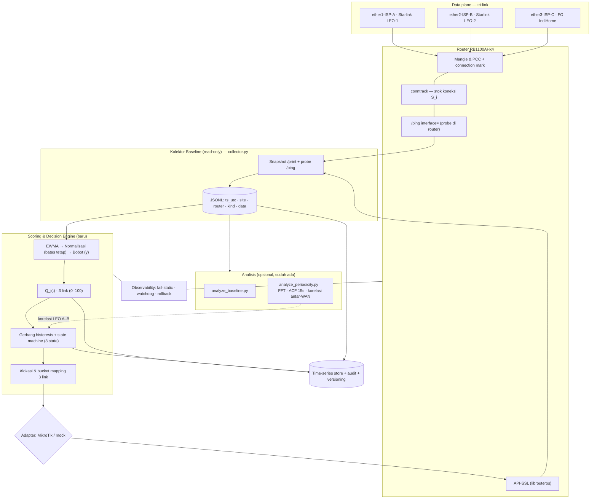

# 15 — Arsitektur Sistem

**Status:** Draf kerja
**Fungsi:** Merancang arsitektur sistem penilaian kualitas link berbasis SAW untuk
topologi **tri-link (1 FO + 2 Starlink)**, **diselaraskan dengan kolektor baseline
yang sudah ada** (`11_Kolektor_Baseline/collector.py`).
**Acuan:** `08_Rancangan_Eksperimen.md`, `00_README.md` §6, `05_Formulasi_ALQI_Adaptif.md`,
`03_Spesifikasi_Parameter.md`.

**Konvensi:** **[FAKTA]** (dari kode/arsip) · **[ANALISIS]** · **[USULAN]**.

---

## 1. Prinsip Arsitektur

1. **Reuse kolektor yang ada.** Komponen pengukuran = `collector.py` yang sudah
   teruji (read-only), bukan modul baru.
2. **Probe dijalankan di router.** Ping per WAN dieksekusi **oleh router** via
   `/ping interface=<iface>`, bukan dari server — sesuai kode.
3. **Pemisahan inti ↔ adapter.** Logika skoring/keputusan (*algorithm core*) terpisah
   dari eksekusi ke perangkat (*platform adapter*, nyata atau mock).
4. **Out-of-band control plane.** Controller di luar data plane.
5. **Aman-ke-gagal (*fail-static*)** + akun read-only (pengamatan) vs write (intervensi).
6. **Tri-link sebagai kesatuan**, dengan korelasi antar-LEO dipantau (dari analisis
   periodisitas kolektor), bukan diabaikan.

---

## 2. Topologi & Pemetaan Interface **[FAKTA]**

Pemetaan mengikuti `PROBE_INTERFACES` pada kolektor:

| Link | Interface | ISP (kode) | Teknologi | Peran |
|---|---|---|---|---|
| L-A | `ether1-ISP-A` | ISP-A | **Starlink (LEO-1)** | Link uji |
| L-B | `ether2-ISP-B` | ISP-B | **Starlink (LEO-2)** | Link uji |
| L-C | `ether3-ISP-C` | ISP-C | **Fiber Optic (IndiHome)** | Link uji |
| LAN | `ether*` (LAN) | — | — | Distribusi pelanggan |
| MGMT | port/VLAN manajemen | — | — | Server Controller (out-of-band) |

**[ANALISIS]** Penamaan dinormalkan memakai **kode ISP (A/B/C)** yang sama dengan
kolektor, agar tidak ada dua sistem label. Alias "WAN1/2/3" tidak dipakai lagi.

---

## 3. Diagram Blok

### 3.1 Mermaid



### 3.2 Diagram teks (portabel)

```
 ether1-ISP-A(Starlink)  ether2-ISP-B(Starlink)  ether3-ISP-C(FO IndiHome)
        │                       │                        │
        └───────────┬───────────┴───────────┬────────────┘
                    ▼                                    ▲
        ┌──────────────────────────────┐        apply mangle/PCC
        │  ROUTER RB1100AHx4           │◄──────────────────┐
        │  mangle/PCC + connection mark│                   │
        │  conntrack (stok S_i)        │                   │
        │  /ping interface= (di router)│                   │
        │  API-SSL (librouteros)       │                   │
        └──────────────┬───────────────┘                   │
                       │ /print + /ping (read-only)        │
                       ▼                                    │
        ┌──────────────────────────────┐                    │
        │ KOLEKTOR  collector.py       │                    │
        │ → JSONL (kind, data)         │                    │
        └───────┬──────────────┬───────┘                    │
                │              │                            │
     analyze_baseline/   ┌─────▼──────────────────────────┐ │
     analyze_periodicity │ SCORING & DECISION ENGINE      │ │
     (FFT, ACF 15s,      │ EWMA→Normalisasi→Bobot(γ)→Q_i(t)│ │
      korelasi antar-WAN)│ → gerbang histeresis (8 state) │ │
                │        │ → alokasi & bucket 3 link     │ │
                │        └─────┬──────────────────────────┘ │
                │              │ policy                     │
                │              ▼                            │
                │        Adapter: MikroTik / mock ──────────┘
                ▼
        Time-series store + audit log + config versioning
        Observability: fail-static · watchdog · snapshot/rollback
```

---

## 4. Lapisan dan Komponen

| # | Lapisan | Komponen | Peran | Implementasi |
|---|---|---|---|---|
| L0 | Data plane | ether1/2/3 | Sumber konektivitas | Starlink ×2 + FO **[FAKTA]** |
| L1 | **Measurement** | `collector.py` | Snapshot `/print` + probe `/ping` per WAN, JSONL | **sudah ada** (read-only) **[FAKTA]** |
| L2 | Analisis | `analyze_baseline.py`, `analyze_periodicity.py` | Episode, RTT/jitter/loss, FFT, ACF 15s, **korelasi antar-WAN** | **sudah ada** **[FAKTA]** |
| L3 | **Scoring** | EWMA → normalisasi → bobot → $Q_i(t)$ | Skor kualitas 3 link | **baru** (`05`) |
| L4 | **Decision** | Gerbang histeresis + state machine + alokasi | 8-state → kebijakan 3 link | **baru** |
| L5 | **Execution** | Adapter MikroTik / mock | Terapkan & verifikasi aturan | **baru** |
| L6 | Data & audit | Time-series store + log + versioning | Reproduksibilitas | **baru** |
| L7 | Observability | Watchdog, fail-static, rollback | Keselamatan operasional | **baru** |

---

## 5. Detail Kolektor Baseline **[FAKTA]**

Diambil dari `collector.py` dan `config.example.env`:

| Aspek | Nilai |
|---|---|
| Transport | librouteros **API-SSL** (`ROS_PORT`, mis. 6187/8729) |
| Endpoint baca | `/system/resource`, `/system/identity`, `/interface`, `/interface/ethernet`, `/ip/address`, `/ip/route`, `/ip/firewall/mangle`, `/ip/firewall/nat`, `/ip/service`, `/user/group`, `/tool/netwatch` (semua `/print`) |
| Probe | `/ping address=<target> count=1 interface=<etherN-ISP-X>` — **dijalankan di router** |
| Stok koneksi | `/ip/firewall/connection/print` → hitung per `connection-mark` (opsional, `--connections`) |
| Probe interfaces | `ether1-ISP-A,ether2-ISP-B,ether3-ISP-C` |
| Probe targets | `1.1.1.1`, `8.8.8.8` |
| Interval (default) | resource 10 s · interface 10 s · route/mangle 60 s · probe **2 s** · connections 120 s |
| Output | JSONL: `{ts_utc, site, router, kind, data}` |
| `kind` | meta, resource, identity, interface, ethernet, address, route, mangle, nat, service, group, netwatch, **probe**, **connection_stock**, error |
| Durasi contoh | `7d` (baseline) |

**Metrik yang diturunkan [FAKTA/ANALISIS]:**

| Parameter | Sumber di kolektor |
|---|---|
| RTT | `probe.rtt_ms` (di-parse dari `time`/`avg-rtt`) |
| Packet loss | `probe.packet_loss` |
| Jitter | deret RTT antar-sampel probe |
| Throughput | delta counter `interface` (per ether) |
| Stok $S_i$ | `connection_stock.by_mark` |
| Periodisitas 15 s | `analyze_periodicity.py` (FFT + ACF lag 15 s) |
| Korelasi antar-LEO | `analyze_periodicity.py` (korelasi antar-WAN) |

**[ANALISIS]** Karena probe sudah ada **di router per interface**, arsitektur tidak
perlu modul probe terpisah di server — cukup **konsumen** JSONL.

---

## 6. Kontrak Antarmuka

| Fungsi | Masukan | Keluaran | Status |
|---|---|---|---|
| `collect()` | konfigurasi `.env` | baris JSONL | **ada** (`collector.py`) |
| `load_samples(kind)` | JSONL | deret metrik per link | baru (pembaca JSONL) |
| `compute_scores(samples)` | deret metrik | $Q_i(t)$ + bobot $w_j(t)$ | baru |
| `evaluate_gate(Q)` | $Q_i(t)$ riwayat | status per link | baru |
| `decide(state)` | status 8-state | kebijakan rasio/bucket | baru |
| `apply(policy)` / `verify(policy)` | kebijakan | hasil tulis & konfirmasi | baru (adapter) |
| `snapshot()` / `rollback()` | — | konfigurasi terakhir valid | baru |

---

## 7. Alur Data

1. **Kolektor** membaca `/print` + menjalankan `/ping` per WAN → tulis JSONL (dsb. §5).
2. **Pembaca JSONL** memuat `probe`, `interface`, `connection_stock` → deret metrik.
3. **Scoring** (L3): EWMA → normalisasi berbatas tetap → bobot hibrida → $Q_i(t)$.
4. **Decision** (L4): gerbang histeresis per link → state 8 kombinasi → alokasi & bucket.
5. **Execution** (L5): adapter menyuntik mangle/PCC via API-SSL (akun write) → verifikasi.
6. **Catat** $Q_i(t)$, status, rasio, dan `corr` (korelasi LEO A–B) ke store.

---

## 8. State Machine Tri-link (8 State)

| State | ISP-A (LEO-1) | ISP-B (LEO-2) | ISP-C (FO) | Tafsir | Aksi [USULAN] |
|:--:|:--:|:--:|:--:|---|---|
| S0 | B | B | B | semua sehat | rasio mengikuti target $Q$ |
| S1 | T | B | B | LEO-1 turun | alihkan dari A |
| S2 | B | T | B | LEO-2 turun | alihkan dari B |
| S3 | B | B | T | FO turun | alihkan dari C |
| S4 | T | T | B | kedua LEO turun | prioritaskan FO |
| S5 | T | B | T | LEO-1 + FO turun | prioritaskan LEO-2 |
| S6 | B | T | T | LEO-2 + FO turun | prioritaskan LEO-1 |
| S7 | T | T | T | semua turun | tahan konfigurasi (*fail-static*) |

**[ANALISIS]** S4 (dua LEO turun bersamaan) adalah uji langsung hipotesis
**korelasi antar-Starlink** — state yang tidak ada pada topologi dual.
Status per link dari gerbang: $Q_i(t) < \theta_{\text{deg}}$ ($k_{\text{down}}$)
→ T; $Q_i(t) > \theta_{\text{pemulih}}$ ($k_{\text{up}}$) → B.

---

## 9. Alokasi & Bucket Mapping (3 link)

$$T_i(t) = \frac{Q_i(t)\, C_i}{\sum_k Q_k(t)\, C_k}, \qquad
b_i = \mathrm{clip}\!\left(\mathrm{round}(T_i \cdot N),\; b_{\min},\; b_{\max}\right),
\qquad \sum_i b_i = N$$

**[USULAN]** $N = 20$, $b_{\min} = 2$, $b_{\max} = 14$; sisa pembulatan dialokasikan
*largest remainder*.

---

## 10. Skema Data

### 10.1 JSONL kolektor **[FAKTA]**
```json
{"ts_utc":"2026-11-13T01:23:45+00:00","site":"rt-rw-net-buru","router":"rb1100ahx4",
 "kind":"probe","data":{"interface":"ether1-ISP-A","target":"1.1.1.1",
 "success":true,"rtt_ms":45.793,"packet_loss":"0","sent":1,"received":1}}
```

### 10.2 Tabel turunan (untuk skoring & audit) **[USULAN]**

| Kolom | Tipe | Keterangan |
|---|---|---|
| `ts_utc` | DATETIME | Waktu sampel |
| `link_id` | VARCHAR | `ISP-A` / `ISP-B` / `ISP-C` |
| `delay_ms`, `jitter_ms`, `loss_pct`, `thr_mbps`, `util_pct` | FLOAT | Metrik |
| `q_score` | FLOAT | $Q_i(t)$ (0–100) |
| `w_d`, `w_j`, `w_pl`, `w_t` | FLOAT | Bobot aktif |
| `hyst_state` | ENUM | BAIK / TERDEGRADASI |
| `b_alloc` | INT | Slot PCC diterapkan |
| `corr_ab` | FLOAT | Korelasi LEO A–B (jendela berjalan) |

---

## 11. Deployment

| Aspek | Staging (L2) | Lapangan (L3) |
|---|---|---|
| Router | uji / `tc/netem` | RB1100AHx4 produksi |
| Kolektor | replay JSONL | `collector.py` live |
| Adapter | **mock** | API-SSL (akun write) |
| Peran | validitas **internal** | validitas **eksternal** |

---

## 12. Parameter Arsitektur

| Parameter | Nilai awal | Rujukan |
|---|---|---|
| Interval probe | 2 s (kolektor) | §5 |
| Interval metrik | 10 s (interface) → **agregasi $T_s$** | §5 |
| $\alpha$ EWMA | 0,10–0,20 | `05` §4 |
| Jendela bobot $N$ | 30–60 sampel | `04` §3.4 |
| $\gamma$ | 0,5 | `04` §3.4 |
| $\theta_{\text{deg}} / \theta_{\text{pemulih}}$ | 60 / 80 | `05` §4 |
| $k_{\text{down}} / k_{\text{up}}$ | 20 / 60 | `08` §8 |
| Slot $N$ | 20 ($b_{\min}$=2, $b_{\max}$=14) | `00_README.md` §6 |

**[ANALISIS]** Kolektor memakai probe 2 s dan interface 10 s, sedangkan skoring
memakai $T_s$ = 1 s → perlu **agregasi/resampling** deret sebelum skoring
(dicalon `NaN`-kan jika tidak ada sampel).

---

## 13. Keamanan, Etika, dan Mode Kegagalan

| Aspek | Rancangan |
|---|---|
| Transport | API-SSL + batasi `address` user ke IP kolektor **[FAKTA]** |
| Akun | **read-only** untuk kolektor; **write** terpisah untuk intervensi |
| Jaringan | jangan buka API ke WAN; pakai VPN/tunnel **[FAKTA]** |
| Data | anonimisasi; tanpa payload/kredensial **[FAKTA]** |
| Gagal | *fail-static*: aturan terakhir tetap; watchdog |
| Perubahan | snapshot → apply → verify → rollback |
| Etika | izin tertulis; pemberitahuan pelanggan; kepatuhan ToS ISP |

---

## 14. Keterkaitan Tahapan

| Komponen | Tahap |
|---|---|
| Pembaca JSONL + skema turunan | **T4** |
| Scoring & Decision Engine + adapter | **T5** |
| Mock adapter + replay JSONL | **T6** |
| Adapter nyata di staging | **T7** |
| Adapter nyata di produksi | **T8** |

---

## 15. Yang Belum Diputuskan **[USULAN]**

- [ ] Penyimpanan turunan: **SQLite** vs **InfluxDB**.
- [ ] Strategi **resampling** probe 2 s → $T_s$ 1 s (interpolasi vs agregasi jendela).
- [ ] Apakah `--connections` (stok $S_i$) diaktifkan berkala (risiko timeout tabel).
- [ ] Apakah telemetri **gRPC dish** Starlink tersedia (di luar kolektor).
- [ ] Alokasi memakai $C_i$ (kapasitas) atau cukup $Q_i$.
- [ ] Ambang korelasi final tri-link vs fallback dual.
